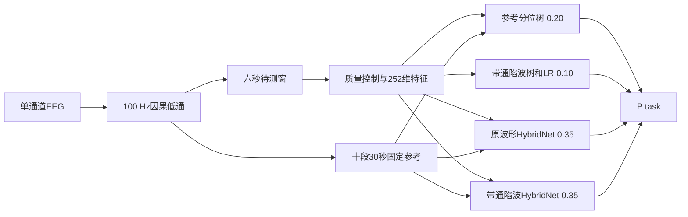

# EEG Cognitive State Decoding for Industrial BCI — 2026 Competition-队长不让叫南脑一号队

[完整复现指南](docs/reproducibility.md) · [发布报告](reports/github_release_report.md)

面向工业场景单通道EEG的relax/task二分类研究代码：250 Hz，输入微伏，relax=0、task=1，输出连续`P(task)`。
仓库包含决赛正式模型**H1x5**，初赛R0 LAG-EnergyProto、D2在线适应和早期严格窗口/切换期研究。

 [GitHub仓库](https://github.com/xiaodongpo/2026BciCompetition)提供H1x5、R0、D2完整最终权重；
 原始EEG、非公开标签和第三方预训练权重不包含。

## 方法与因果边界



H1x5两个网络成员各5种子，两个树成员各3种子，训练不需要外部预训练权重。推理只按固定参考标准化，不从待测窗口顺序学习。完整架构见[模型说明](docs/model_architecture.md)。

| 路线 | 主要方法 | 时间支持与协议 |
| --- | --- | --- |
| H1x5，决赛正式 | 参考条件化树/LR与HybridNet融合 | 六秒待测窗；固定参考及全局因果IIR超出六秒；预测调用顺序独立 |
| R0，初赛正式 | CNN能量表示、LightGBM、动态原型 | 原始缓冲最多1500点；在线统计/原型有更早历史 |
| D2，历史路线 | 在线分位树与严格树/LR融合 | 原始特征窗最多1500点；参考历史和沿用评分超出六秒 |
| legacy | 经典模型、CNN/TCN、迁移与切换训练研究 | 保留严格端到端六秒实现及测试，逐配置核查 |


## 快速开始

```powershell
git clone https://github.com/xiaodongpo/2026BciCompetition.git
cd 2026BciCompetition
py -3.11 -m venv .venv
.\.venv\Scripts\Activate.ps1
$env:PYTHONUTF8 = '1'
$env:OMP_NUM_THREADS = '1'
python -m pip install torch==2.7.1 --index-url https://download.pytorch.org/whl/cpu
python -m pip install -r requirements-dev.txt
python -m pip check
python -m pytest -q
python scripts/verify_weights.py --route h1 --model checkpoints/h1
python scripts/h1_synthetic_smoke.py --model checkpoints/h1 --out cache/h1_final_check
python scripts/h1_synthetic_smoke.py --out cache/h1_demo
python scripts/synthetic_smoke.py --out cache/r0_demo
python scripts/evaluate_predictions.py examples/sample_output/metric_fixture.csv
```

查看`cache/h1_demo/report.json`及`cache/r0_demo/predictions.csv`。示例由固定种子生成，不包含真实受试者数据，模型只用于功能测试。
两类CI完成在线依赖安装与全部17项测试，见[CI验收](results/validation/github_actions.json)和[安装说明](docs/installation.md)。

## 数据、训练与推理

合法数据按`<data_root>/<record_id>/*.bdf`和`*_events.csv`组织。MNE读入伏特后转换微伏，以文件名毫秒时间戳UTC+08:00对齐事件，配对完整trial_start/trial_end，保留BAD缺口时间轴；阶段、坏窗和参考处理按路线协议区分。没有已授权公开下载地址，见[数据说明](docs/dataset.md)。

```bash
python scripts/validate_data.py --data-root /path/to/authorized_data --output cache/data_manifest.json
python scripts/run_route.py --data-root /path/to/authorized_data h1 scripts.finals.build_cache
python scripts/run_route.py --data-root /path/to/authorized_data h1 scripts.finals.build_cache --bpn
```

随后按[训练说明](docs/training.md)执行H1x5两个网络分支各5种子、30 epochs及最终导出。开发集真实接口CV命令见[评价说明](docs/evaluation.md)。

H1接口为`filter_eeg(bdf_path)`和`predict(window, reference)`，模型目录由`FIN_MODEL_DIR`设置。R0连续分块推理示例：

```bash
python routes/r0/run_inference.py --input cache/r0_demo/raw_eeg_uv.npy --model cache/r0_demo/model --output cache/r0_demo/replayed.csv --device cpu
```

输出应结合`valid`判断，0.5中性回退不等于确定task。完整模型加载、参考输入、坏窗回退和重置说明见[推理文档](docs/inference.md)。

## 历史结果（本次未重跑）

| 模型与独立协议 | AUC | bACC | ACC |
| --- | ---: | ---: | ---: |
| D2，46记录5折×20顺序均值，pooled | 0.700424 | 0.647805 | — |
| H1，46记录5折，真实接口，记录等权 | 0.710315 | 0.652764 | 0.652445 |
| H2，同H1开发协议 | 0.709913 | 0.652543 | 0.652303 |

这些行不能跨协议排名。H1/H2每记录平均参考种子14/15/16，决赛score=(AUC+ACC)/2；初赛通常使用(AUC+bACC)/2。H1开发模型不等于全57记录拟合的H1x5正式权重。
[实验总结](docs/experiments.md)包含早期基线、未晋级结果、过渡期消融、D2最差顺序及已保存历史锁箱结果的边界。

## 仓库结构与复现证据

```text
routes/h1/       决赛训练、评价、正式推理实现及冻结配方
routes/r0/       LAG-EnergyProto完整最终拟合与连续流推理
routes/d2/       冻结CV、顺序压力测试、最终拟合
routes/legacy/   早期基线、迁移、双向切换研究及测试
scripts/        统一路线入口、数据/模型核验、合成验收、安全检查
tests/          无真实数据CPU验收
docs/           数据、安装、训练、评价、推理、架构与复现
results/        历史汇总与本次脱敏验证证据
checkpoints/    H1x5、R0、D2最终权重、配置及哈希清单
.github/        Windows/Linux合成CPU CI配置
```

## 权重、引用和许可

[模型清单](checkpoints/README.md)记录36项SHA-256和大小，其中34个H1x5/R0/D2最终模型及配置文件经所有者授权随仓库公开，约52.2 MB；2个第三方预训练文件仍排除。加载前运行`python scripts/verify_weights.py --route h1 --model checkpoints/h1`核验。

所有者已确认采用[MIT](LICENSE)并公开最终权重；BIOT/SingLEM原始MIT声明保留，其第三方预训练权重不分发，见[第三方声明](THIRD_PARTY_NOTICES.md)。比赛数据和官方文件不由本项目重新授权。

[CITATION.cff](CITATION.cff)提供仓库软件引用，以维护者GitHub账号及贡献者集体署名；感谢赛事组织方、团队贡献者及所用开源项目。
