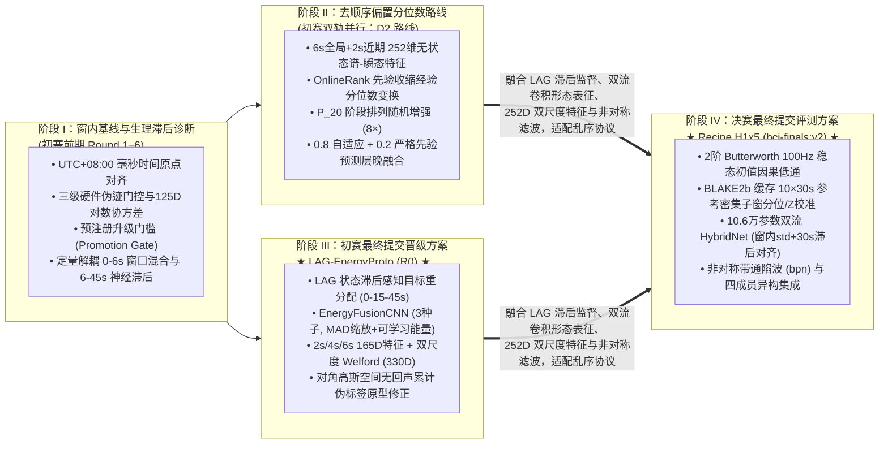

# 2026 脑机接口大赛工业场景脑电认知状态解码赛道：终版技术方案报告
## —— 从初赛 状态滞后感知流式自适应架构 (`LAG-EnergyProto`) 到决赛 参考锚定多视图异构协同系统 (`Recipe H1x5`) 的全周期技术演进

**项目名称**：工业场景单通道脑电认知负荷解码：基于生理滞后感知、去顺序偏置校准与双流异构协同的全周期演进架构  
**赛道名称**：2026 脑机接口大赛 · 工业场景脑电认知状态解码赛道  
**初赛最终提交晋级模型**：`LAG-EnergyProto`（状态滞后感知多尺度能量卷积网络 + 双尺度 Welford 树模型 + 累计伪标签原型修正）  
**决赛最终提交评测模型**：`Recipe H1x5`（镜像 **`bci-finals:v2`**，因果稳态低通滤波 + `BLAKE2b` 参考锚定校准 + 非对称滤波双流 `HybridNet` 与分位树四成员集成）  
**撰写日期**：2026 年 11 月 17 日  

---

## 1. 摘要 (Executive Summary)

### 1.1 赛题核心挑战与初/决赛范式变迁
在 2026 脑机接口大赛“工业场景脑电认知状态解码赛道”中，算法需仅凭**单通道、$250\text{ Hz}$ 采样率的非侵入式原始脑电（EEG）信号**，识别作业人员处于**静息放松态（`relax = 0`）**还是**操作机械臂进行木块搬运的认知负荷态（`task = 1`）**，输出连续概率评分 $P(\text{task}) \in [0, 1]$。纵观初赛与决赛两个阶段，解码系统面临五大物理与工程挑战：
1. **单通道空间盲源与极端硬件伪迹**：缺乏多通道空间拓扑（无 CSP 或空间滤波可用）；原始 BDF+C 数据存在高达 $-58,000\sim +140,000\ \mu\text{V}$ 的电极直流漂移、48/57 份记录出现未标注的 $\pm 403,333\ \mu\text{V}$ ADC 满量程轨饱和、56/57 份记录存在解码后恒为 **$+0.024\ \mu\text{V}$**（而非精确 $0.0$）的 `BAD_ACQ_SKIP` 补零缺口，以及 $>20,000\ \mu\text{V}$ 采样跳变与电极脱落平直段。
2. **跨受试者基线鸿沟与固定实验顺序陷阱（Order Confounding）**：官方数据集共 $57$ 份记录（$342$ 个实验阶段），无受试者 ID，且个体间基线方差远超状态差异（约 $20\%\text{--}25\%$ 记录呈现频谱效应反转）。更严峻的是，**全部 $57$ 份训练记录 100% 遵循固定的 `relax → task → relax → task → relax → task`（`rtrtrt`）交替顺序**。朴素在线自适应会隐式记忆“开局必为 `relax`”的虚假顺序先验，在逆序测试（如 `tttrrr`）下发生灾难性退化（AUC 跌至 $0.534$）。
3. **实验阶段切换的双向神经生理过渡滞后（Bidirectional Transition Lag）**：本团队通过严格的跨阶段轨迹审计证实，即使完全排除跨越阶段边界的混合窗口，阶段切换后 $6\text{--}20\text{ s}$ 的纯阶段窗口相对 $60\text{ s}+$ 稳定期仍存在高达 $+27.16\%\sim +29.73\%$ 的分类错误增量，直接用官方硬边界标签训练深度网络会产生严重的边界梯度污染。
4. **初赛严格因果流式约束（Streaming Causal Constraint）**：单次判断窗口及算子有效感受野 $\le 6\text{ s}$（$1500$ 点），支持任意块长实时分块输入，严禁使用未来样本或双向滤波（`filtfilt`），但允许利用过去已到达的无标签数据执行因果在线自适应。
5. **决赛乱序独立窗口与参考锚定约束（Shuffled Reference-Anchored Constraint）**：决赛评测改为两阶段离线容器调用——先对整条 BDF 执行纯单向因果滤波 `filter_eeg(bdf_path)`（禁止归一化或剔除缺口），随后组委会从前 $10\text{ min}$ 随机抽取 $10\times 30\text{ s}$ 无标签参考片段，并将全部待测 $6\text{ s}$ 窗口**彻底随机打乱**后逐个调用 `predict(window, reference)`。**初赛依赖的跨窗口连续流状态（如 Welford 递推矩、连续多窗平滑、累计原型更新）在决赛中被严格禁止**，且 10 条 30 分钟记录在单核 CPU 容器中的全流程总耗时必须 $< 60\text{ 分钟}$（$3600\text{ s}$）。

### 底层信号全量审计与硬件/生理伪迹剖析

我们对官方全部 $57$ 份记录（编号 `001–031`、`034–059`，共 $342$ 个阶段，累计有效 `relax` $49,858.56\text{ s}$ / $13.85\text{ h}$，有效 `task` $50,228.36\text{ s}$ / $13.95\text{ h}$，缺失段 $2,754.97\text{ s}$）进行了逐样本底层审计（`scripts/analyze_dataset.py`、`r0/signal.py`），揭示了以下关键异常：

## 电极直流漂移（DC Offset & Drift）：$-58,000\sim +140,000\ \mu\text{V}$

* **物理成因**：
  常规头皮脑电（EEG）的有效生理交流信号幅值非常微弱，通常仅为 **$10\sim 100\ \mu\text{V}$**。但在直流耦合（DC-coupled）生物电放大器采集过程中，皮肤-电极界面的电化学半电池电位（Half-cell potential）、出汗或导电膏湿度变化会产生巨大的慢变极化电压。
* **数据实证**：
  对 57 份录音实测发现，不同记录的信号均值分布在 **$-58,000\ \mu\text{V}$ 到 $+140,000\ \mu\text{V}$（即 $-58\text{ mV}\sim +140\text{ mV}$）** 之间，比真正的脑电信号大 **1,000 到 10,000 倍**，且随时间缓慢漂移。
* **工程对策**：
  1. **窗口内线性去趋势**：如果不在局部窗口内做一阶线性去趋势（Linear Detrending），直接计算 FFT 或送入神经网络，巨大的直流分量会通过频谱泄漏（Spectral Leakage）彻底淹没 $\delta/\theta/\alpha$ 等低频生理节律。
  2. **滤波器稳态初始化**：在决赛 `filter_eeg`（`finals/submission/submission.py`）中，必须使用**首样本稳态初始化（$\mathbf{z}_0 = \mathbf{z}_{\text{ss}}\cdot x[0]$）** 的低通滤波器；若从零状态（$\mathbf{z}_0=\mathbf{0}$）开始滤波，信号开头的几十毫伏直流分量相当于一个巨大的阶跃输入，会激起剧烈的滤波器瞬态振铃。

---

## 未标注的 $\pm 403,333\ \mu\text{V}$ ADC 满量程轨饱和（Rail Saturation）：48/57 份记录出现

* **物理成因**：
  `BDF`（BioSemi Data Format）采用 **24-bit 有符号整型**存储采样值，文件头定义了物理量程为 $\pm 403,333\ \mu\text{V}$（约 $\pm 0.403\text{ V}$）。当受试者剧烈运动、触碰电极或实验结束摘下电极时，放大器输入电压超出模数转换器（ADC）的最大上限或下限，输出值就会被“卡死”在正负满量程边界（即撞轨，Rail Saturation）。
* **数据实证**：
  * 57 份记录中有 **48 份**出现了高达 $\pm 403,333\ \mu\text{V}$ 的饱和段，且**官方标注（Annotations）完全没有标记这些饱和伪影**。
  * 虽然约 61% 的饱和发生在实验结束摘电极时，但有大量饱和直接落在了实验计分阶段内（例如 `008` 号记录在第 6 段 `task` 期间连续饱和 266 秒，`022` 饱和 135 秒，`009`/`013` 各饱和 58 秒）。
  * 如果不剔除，仅 `008` 号记录在 `task` 与 `relax` 之间的 $\alpha$ 频带功率对数差就会产生 **$-6$ 个 $\log_{10}$ 数量级（即百万倍）** 的畸变。
* **工程对策**：
  在 `src/preprocessing/quality.py` 中设置硬阈值 `RAIL_UV = 400_000.0`，推理时无需依赖外部标注，直接将 $\lvert x[n]\rvert \ge 400,000\ \mu\text{V}$ 的采样点自动识别为轨饱和伪影并予以掩码剔除。

---

## 解码后恒为 $+0.024\ \mu\text{V}$（而非精确 $0.0$）的 `BAD_ACQ_SKIP` 补零缺口：56/57 份记录存在

* **物理与编码成因（为什么不是 $0.0$？）**：
  无线脑电传输丢包或采集中断时，采集软件在 BDF 文件中写入了 `BAD_ACQ_SKIP` 事件并执行了“数字补零”（即将 24-bit 原始整型值填为 `Digital = 0`）。
  然而，BDF 格式将数字量转换为物理电压（$\mu\text{V}$）时遵循非对称线性映射公式：
  $$x_{\text{phys}} = \text{Gain} \times (x_{\text{digital}} - \text{Digital}_{\min}) + \text{Physical}_{\min}$$
  由于 24-bit 有符号整数的范围是不对称的（$-2^{23} = -8,388,608$ 到 $+2^{23}-1 = +8,388,607$），而物理量程是对称的（$\pm 403,333\ \mu\text{V}$），导致数字 `0` 映射回物理电压时存在半个 LSB（最低有效位）的零点偏移：
  $$x_{\text{phys}}(0) = \frac{403333 - (-403333)}{8388607 - (-8388608)} \times 0.5 \approx +0.02404\ \mu\text{V}$$
* **数据实证**：
  57 份记录中有 **56 份**（除 `030` 外全部）包含这种传输中断缺口，总计长达 $2,755\text{ s}$（其中 `034` 缺失 $1,047\text{ s}$，`009` 缺失 $464\text{ s}$）。
* **工程对策**：
  1. **连续近零游程检测**：官方赛题说明写的是“缺失处已补零”，若直接写 `x == 0.0` 检测缺失段，**检出率将是 0%**。因此项目中采用连续近零游程检测：当连续 $\ge 3$ 个采样点满足 $\lvert x[n]\rvert < 0.1\ \mu\text{V}$（`ZERO_FILL_UV = 0.1`）时，判定为 `BAD_ACQ_SKIP` 缺口。
  2. **单位直流增益（Unit DC Gain）滤波**：这也决定了决赛 `filter_eeg` **绝不能使用高通或带通滤波器**——一旦在 `filter_eeg` 阶段滤除直流，缺口原本恒为 $+0.024\ \mu\text{V}$ 的特征就会被破坏并叠加滤波振铃尾巴，导致后续 `predict` 阶段再也无法识别缺口。因此决赛专门设计了**单位直流增益（$H(0)=1.0$）** 的 $100\text{ Hz}$ 低通滤波器，使 $+0.024\ \mu\text{V}$ 缺口在滤波后严丝合缝地保持原值。

---

## $>20,000\ \mu\text{V}$ 采样跳变与电极脱落平直段（Step Jumps & Flatlines）

* **物理成因**：
  * **$>20,000\ \mu\text{V}$ 采样跳变**：发生在两类时刻——一是 `BAD_ACQ_SKIP` 补零缺口（$+0.024\ \mu\text{V}$）与正常高直流偏移信号（数万微伏）交界的恢复瞬间；二是受试者头部突发碰撞导致电极接触阻抗突变，产生阶跃式基线跳变（Step artifact）。
  * **电极脱落平直段（Flatlines）**：电极短暂悬空或放大器锁死时，信号虽然不处于 $+0.024\ \mu\text{V}$ 或 $\pm 403,333\ \mu\text{V}$，但一阶差分恒为 $0$（$x[n] - x[n-1] = 0$，即数值冻结成一条水平直线）。
* **工程对策**：
  * **初赛（`LAG-EnergyProto`）**：在 `clean_segment_or_none` 质量门控函数中专门加入了“一阶差分平直段检测”与“相邻点突变 $\lvert\Delta x\rvert > 20,000\ \mu\text{V}$ 拦截”。
  * **决赛（`Recipe H1x5`）**：当 $6\text{ s}$ 切片内包含上述缺口或饱和跳变时，低通滤波器在阶跃边界会产生约 $34$ 个采样点的瞬态过渡。决赛算法在检测到的任何坏点前后各扩张 **$\pm 40$ 个采样点（$0.16\text{ s}$）的边界守卫带（Settling Guard）**（见 `finals/submission/submission.py` 中的 `_longest_clean_run`），并仅截取守卫带之外**最长的连续洁净子段**（要求 $\ge 3\text{ s}$）计算频谱与输入神经网络，从而实现 100% 的伪影隔离。

---

## 四类伪影与工程对策速查表

| 伪影类型 | 实测幅值 / 数量级 | 出现频率 | 物理 / 编码根因 | 核心工程对策 |
| :--- | :--- | :--- | :--- | :--- |
| **电极直流漂移** | $-58,000 \sim +140,000\ \mu\text{V}$ | 57/57 (100%) | 皮肤-电极半电池极化电位 | 窗内一阶线性去趋势 + IIR 滤波器首样本稳态初始化 $\mathbf{z}_{\text{ss}}\cdot x[0]$ |
| **ADC 满量程轨饱和** | $\pm 403,333\ \mu\text{V}$ | 48/57 (84.2%) | 运动/碰触电极导致放大器超出 24-bit ADC 量程（未标注） | 硬阈值盲检测 $\lvert x[n]\rvert \ge 400,000\ \mu\text{V}$ |
| **`BAD_ACQ_SKIP` 缺口** | 恒为 $+0.024\ \mu\text{V}$ | 56/57 (98.2%) | 无线丢包数字补零（`Digital=0`）经非对称整数区间映射产生半个 LSB 偏移 | 连续 $\ge 3$ 点满足 $\lvert x[n]\rvert < 0.1\ \mu\text{V}$ 游程检测 + 单位直流增益滤波保留 |
| **阶跃跳变与平直段** | $\lvert\Delta x\rvert > 20,000\ \mu\text{V}$ 或 $\Delta x = 0$ | 伴随缺口/接触不良 | 缺口恢复瞬间的高直流跳变或放大器短暂锁死 | 坏点边界扩张 $\pm 40$ 点（$0.16\text{ s}$）守卫带 + 提取最长连续洁净段（$\ge 3\text{ s}$） |

**并行采集重叠与无受试者 ID** ：
 编号文件夹命名，无受试者标识 
  时间戳审计发现 42 份记录间存在 **68 对采集时间重叠**（可归并为 23 个时间连通分量），频谱自相关达 $0.995$ 但跨人最高亦达 $0.993$ 
  严禁按窗口随机划分！必须按整份记录或时间连通采集组（Overlap-Group）进行隔离交叉验证，并封存独立 Lockbox 

### 1.2 全周期技术演进路线图
围绕上述挑战与赛制变迁，本团队开展了贯穿“初赛探索—初赛定型晋级—流式深化—决赛重构”的四阶段体系化攻关：

## Phase I（Round 1–6）三大基石机制深度解析：硬件伪迹门控、125D 对数协方差、预注册升级门槛与滞后解耦

在 `Technical_Proposal.md` 的 **1.2 节（全周期技术演进路线图）**中，第一阶段 **`Phase I: 严格 6s 基线与滞后诊断 (Round 1–6)`** 的三项核心工作，奠定了整个项目在**底层信号质量防线、单通道流形特征工程、防过拟合科研纪律**以及**神经生理过渡期建模**上的理论与实证基础。

---

###  三级硬件伪迹门控与 125D 对数协方差（`FilterBank-LogCov-125D`）

###  三级硬件伪迹门控（Three-Stage Hardware Quality Gating）
为确保极端硬件伪影绝不污染特征提取器与后续在线统计量，系统构建了三道严格因果的质检防线：
1. **第一级（协议注释与非有限值拦截）**：读取 BDF+C 中的 `BAD_ACQ_SKIP` 采集中断区间并标记为无效，同步拦截 `NaN / Inf`。
2. **第二级（ADC 硬件量化边界盲检测）**：不依赖外部标签，仅凭原始微伏信号自动识别并剔除 4 类硬件异常：
   * **伪零补零缺口**：$\lvert x[n]\rvert < 0.05\ \mu\text{V}$（或连续 $\ge 3$ 点 $<0.1\ \mu\text{V}$），精准捕获解码后恒为 $+0.02404\ \mu\text{V}$ 的丢包填零段；
   * **24-bit ADC 满量程轨饱和**：$\lvert x[n]\rvert \ge 403,000\ \mu\text{V}$（物理满量程为 $\pm 403,333\ \mu\text{V}$）；
   * **接触阻抗阶跃跳变**：相邻采样点一阶差分 $\lvert x[n] - x[n-1]\rvert > 20,000\ \mu\text{V}$；
   * **电极脱落量化平直段**：连续 $\ge 250$ 点（$1.0\text{ s}$）相邻差分不超过 $\frac{1}{4}\Delta_{\text{ADC}} = 0.01202\ \mu\text{V}$。
3. **第三级（推理期优雅降级与状态冻结）**：一旦当前窗口未通过质检，**严禁更新任何在线均值、分位数或类别原型**（防止单次伪影污染整场 30 分钟的基线），并自动降级为截取窗口末端最长连续洁净后缀（$\ge 3\text{ s}$）或保持上一有效时刻评分。

### 125D 对数协方差特征（`FilterBank-LogCov-125D`）
* **设计动机**：多通道脑电解码常依赖黎曼空间协方差矩阵（Riemannian Covariance），但单通道脑电的常规协方差退化为 $1\times 1$ 标量方差。为在单通道上重建对称正定（SPD）协方差流形，我们在 `Round 2` 结合 **251-tap FIR 滤波器组**与 **Takens 时滞嵌入**升维构造了两类对数协方差表征：
  1. **6 频带滤波器组对数协方差流形（Filter-Bank Log-Covariance）**：将单通道信号滤波分解为 $\delta, \theta, \alpha, \beta_{\text{lo}}, \beta_{\text{hi}}, \gamma_{\text{lo}}$ 共 $6$ 个并行子带通道 $\mathbf{X}_{\text{FB}} \in \mathbb{R}^{6 \times T}$，计算 $6\times 6$ 跨频带协方差矩阵 $\mathbf{C}_{\text{FB}} = \frac{1}{T}\mathbf{X}_{\text{FB}}\mathbf{X}_{\text{FB}}^\top + \epsilon\mathbf{I}$，经矩阵对数映射 $\log(\mathbf{C}_{\text{FB}})$ 提取上三角元素（$21$ 维），显式刻画**跨频带能量协同与耦合（Cross-Frequency Coupling）**；
  2. **时滞嵌入对数协方差流形（Delay-Embedding Log-Covariance）**：按不同时间延迟 $\tau$ 将单通道序列堆叠为多维相空间轨迹矩阵 $\mathbf{X}_{\text{delay}}$，提取其对数协方差上三角特征，刻画脑电波形的**自相关相空间几何结构**；
  3. **跨子窗中位数鲁棒谱与瞬态统计**：与 $46$ 维中位数频带功率、$1/f$ 谱斜率及 Hjorth 参数融合，形成 **$125$ 维特征向量**。
* **实证表现**：仅配合 $126$ 个浮点参数的 $L_2$ 逻辑回归（单窗耗时 $2.38\text{ ms}$），便在 12 条独立留出集上达到 **$\text{AUC}=0.6449$**，大幅超越 318 万参数的 `BIOT`（$0.5739$）与 327 万参数的 `SingLEM`（$0.5711$）等大型预训练脑电模型。

---

## 预注册升级门槛（Pre-registered Promotion Gate）

* **设计动机**：在仅有 57 份记录的小样本数据集上，若仅凭交叉验证均值微弱提升就频繁更换模型，极易陷入**多重假设检验与验证集选择过拟合（Selection Bias）**。
* **四项强制准入判据（一票否决制）**：
  在 `Round 1–6` 迭代中，任何新候选方案必须**同时通过以下 4 项预注册门槛**方可替换主基线：
  1. **配对 Bootstrap 置信区间显著性**：对 45 条开发记录进行 $10,000$ 次记录级配对 Bootstrap 重采样，综合分 $\frac{\text{bACC}+\text{AUC}}{2}$ 的增量 $95\%$ 置信区间下界必须**严格 $> 0$**（如 Round 2 `125D` 的 $95\%$ CI 为 $[+0.0027, +0.0247]$，通过；而 Round 5 排列熵的 $95\%$ CI 为 $[-0.0041, +0.0093]$ 跨零，被否决）；
  2. **三外折全胜一致性**：3 个记录隔离外折（Outer Folds）必须**全部取得正向提升**；
  3. **采集日期留组压力测试不退步**：在 4 折按采集日期留组（Leave-Date-Group-Out）测试中性能不得下降，杜绝模型记忆特定日期的环境底噪；
  4. **记录级宏平均（Record-Macro）$\text{bACC}$ 不退步**：确保每条记录均衡受益。

---

## 定量解耦 $0\text{--}6\text{ s}$ 窗口混合与 $6\text{--}45\text{ s}$ 神经滞后

* **核心科学问题**：实验阶段刚切换后的高分类错误率，究竟源于**滑动窗口跨越阶段边界的物理信号混合**，还是源于**受试者真实神经生理状态的建立与消退滞后**？
* **Round 6 精细时间分桶审计（45 条记录，$135$ 次 `relax→task` 与 $90$ 次 `task→relax`）**：
  按窗口末端距当前阶段起点的相对时间 $e = t - t_{\text{start}}$ 进行分段剖析，首次实现了两者的定量解耦：

| 时间区间 $e$ | 物理窗口状态 | `relax → task` Recall | `task → relax` Specificity | 物理与生理机制定性 |
| :--- | :--- | :---: | :---: | :--- |
| **$0 \le e < 6\text{ s}$** | 跨边界混合窗（含 $6-e$ 秒旧阶段波形） | $0.3667 \sim 0.3741$ | $0.2778 \sim 0.3667$ | **物理窗口混合效应（Window Mixing）** + 生理未切换 |
| **$6 \le e < 20\text{ s}$** | **$100\%$ 纯新阶段窗口（零物理混合）** | **$0.3667 \sim 0.4481$** *(较稳定期错误率 $+29.73\%$)* | **$0.2444 \sim 0.2778$** *(较稳定期错误率 $+27.16\%$)* | **纯粹的神经生理与行为滞后**：大脑尚未进入任务负荷或刚结束任务后 $\theta/\alpha/\beta$ 兴奋性尚未消退 |
| **$20 \le e < 45\text{ s}$** | $100\%$ 纯新阶段窗口 | $0.4646 \to 0.6563$ | $0.2333 \to 0.2972$ | **非平稳神经状态过渡爬坡期** |
| **$e \ge 60\text{ s}$** | $100\%$ 纯新阶段稳定参照期 | **$0.7060$** | **$0.5367$** | **稳态认知负荷 / 稳态静息期** |

* **直接指导的算法创新**：
  该定量解耦证实，即使彻底排除了 $0\text{--}6\text{ s}$ 的窗口混合，$6\text{--}45\text{ s}$ 的纯窗口依然处于强烈的生理滞后与过渡态。若在训练时强行赋予当前阶段的官方硬标签，会严重污染决策边界。这一发现直接催生了初赛 **`LAG-EnergyProto` 的三段式 LAG 监督机制**（$[0,15)\text{ s}\to y_{\text{prev}}$，$[15,45)\text{ s}\to\text{Mask}$，$\ge 45\text{ s}\to y_i$）与决赛 **`Recipe H1x5` 的 $\Delta t_{\text{lag}}=30\text{ s}$ 滞后清洗机制**，使分类器 AUC 实现了 $>1.1\sim 1.8\%$ 的净跃升。

---

## 2. 问题定义与赛题痛点深度剖析 (Problem Formulation & Challenges)

### 2.1 初赛与决赛双阶段形式化数学建模

设单通道脑电离散时间序列为 $x[n] \in \mathbb{R}$，采样率 $f_s = 250\text{ Hz}$，物理单位为微伏（$\mu\text{V}$）。初赛与决赛在推理契约与信息结构上构成了两种截然不同的数学映射：

#### 1. 初赛范式：严格因果连续流式解码（提交模型：`LAG-EnergyProto`）
在任意决策时刻 $t_k = n_k / f_s$（步长 $\Delta n = 250$ 点即 $1.0\text{ s}$），流式解码器 $\mathcal{D}_{\text{stream}}$ 仅能访问截至 $n_k$ 的近期滑动窗口 $\mathbf{x}_{n_k} = x[n_k - L + 1 : n_k + 1]$（最大窗长 $L_{\max} = 6 f_s = 1500$ 点）以及由严格早于 $n_k$ 的历史无标签有效窗口构建的内部压缩状态 $\mathcal{H}_{k-1}$（包含在线矩 `RunningMoments`、Logit 中心化累加器及动态类别原型 $\mathbf{S}_{k,c}^{(k-1)}$）：
$$\hat{p}_k = \mathcal{F}_{\Theta}\big(\mathbf{x}_{n_k};\, \mathcal{H}_{k-1}\big), \qquad \mathcal{H}_k = \mathcal{U}\big(\mathcal{H}_{k-1},\, \mathbf{x}_{n_k},\, L_{\text{fused},k}\big)$$
该过程严格遵循 **“先判断、后更新”** 与**未来扰动不变性（Future Perturbation Invariance）**：
$$\frac{\partial \hat{p}_k}{\partial x[n]} \equiv 0, \quad \forall n > n_k$$
初赛综合评价指标为跨样本/跨记录的平衡准确率 $\text{bACC} = \frac{1}{2}(\text{TPR} + \text{TNR})$ 与 $\text{ROC-AUC}$。

#### 2. 决赛范式：因果滤波 + 无标签参考锚定乱序独立解码（提交模型：`Recipe H1x5`）
决赛评测由组委会统一调度 `/submission/solution.py` 中的两个纯函数接口：
- **全局因果滤波函数 `filter_eeg(bdf_path)`**：输入完整 BDF 路径，输出与原始采样点一一对应的一维浮点数组 $\tilde{x} \in \mathbb{R}^N$（$\forall n, \frac{\partial \tilde{x}[n]}{\partial x[m]} \equiv 0, \forall m > n$）。此阶段**只允许单向因果滤波**，严禁归一化、去均值、特征提取或利用 BDF 标注。
- **乱序单窗预测函数 `predict(window, reference)`**：组委会从 $\tilde{x}$ 的前 $10\text{ min}$（$150,000$ 点）6 秒网格中随机抽取 $10$ 段互不重叠的 $30\text{ s}$ 无标签参考脑电 $\mathbf{R} \in \mathbb{R}^{10 \times 7500}$ 并打乱其顺序；随后将其余完整 $6\text{ s}$ 窗口 $\mathbf{w}_j \in \mathbb{R}^{1500}$ 全部随机打乱后逐一调用：
  $$\hat{p}_j = \mathcal{G}_{\Phi}\big(\mathbf{w}_j,\, \mathbf{R}\big) \in [0, 1]$$
  **核心约束转变**：在决赛中，$\mathcal{G}_{\Phi}$ 必须是 $(\mathbf{w}_j, \mathbf{R})$ 的**无状态纯函数**——输出不得依赖调用次数、窗口输入顺序或参考片段顺序：
  $$\mathcal{G}_{\Phi}\big(\mathbf{w}_{\pi(j)},\, \sigma(\mathbf{R})\big) \equiv \mathcal{G}_{\Phi}\big(\mathbf{w}_{\pi(j)},\, \mathbf{R}\big), \quad \forall \text{窗口排列 }\pi, \text{ 参考段排列 }\sigma$$
  每位受试者的得分为 $\text{Score}_i = \frac{1}{2}\big(\text{AUC}_i + \text{ACC}_i\big|_{\tau=0.5}\big)$，最终算法得分为所有受试者得分的算术平均。

---

### 2.3 实验阶段切换的双向神经生理过渡滞后定量诊断（Round 6 核心发现）

在每个实验阶段起始时刻 $t_{\text{phase}}$，设窗口相对阶段起点的流逝时间为 $e = t - t_{\text{phase}}$。早期实验发现阶段切换初期错误率极高，但究竟源于 **“现象 A：$6\text{ s}$ 窗口跨越阶段边界的物理信号混合（$0 < e < 6\text{ s}$）”** ，还是 **“现象 B：受试者大腦进入/退出认知负荷的真实神经生理滞后（$e \ge 6\text{ s}$）”**？

我们在 Round 6 对 $45$ 份开发记录的全部 $135$ 次 `relax → task` 切换与 $90$ 次 `task → relax` 切换（共 $38,391$ 个有效窗口，其中 $37,693$ 个为完全落在同一阶段内的纯窗口）进行了严格的分段统计审计：

#### 表 2.1：阶段切换后不同流逝时间区间 $e$ 的分类召回率、特异度与预测概率演化轨迹

| 距阶段开始流逝时间 $e$ (秒) | $0\text{--}2\text{ s}$ *(跨界混合)* | $2\text{--}4\text{ s}$ *(跨界混合)* | $4\text{--}6\text{ s}$ *(跨界混合)* | **$6\text{--}10\text{ s}$** *(100%纯窗)* | **$10\text{--}15\text{ s}$** *(100%纯窗)* | **$15\text{--}20\text{ s}$** *(100%纯窗)* | **$20\text{--}30\text{ s}$** *(100%纯窗)* | $30\text{--}60\text{ s}$ *(过渡后期)* | **$60\text{ s}+ \text{ (稳态)}$** *(基准参照)* |
| :--- | :---: | :---: | :---: | :---: | :---: | :---: | :---: | :---: | :---: |
| **`relax → task` 阶段 Recall** | $0.3741$ | $0.3704$ | $0.3667$ | **$0.4481$** | **$0.4241$** | **$0.3667$** | **$0.4646$** | $0.6563$ | **$0.7060$** |
| **`relax → task` 平均 $P(\text{task})$** | $0.4106$ | $0.4054$ | $0.4094$ | **$0.4367$** | **$0.4319$** | **$0.4208$** | **$0.4417$** | $0.5208$ | **$0.5373$** |
| **`task → relax` 阶段 Specificity** | $0.3111$ | $0.3667$ | $0.2778$ | **$0.2444$** | **$0.2630$** | **$0.2778$** | **$0.2333$** | $0.2972$ | **$0.5367$** |
| **`task → relax` 平均 $P(\text{task})$** | $0.5325$ | $0.5258$ | $0.5391$ | **$0.5459$** | **$0.5393$** | **$0.5468$** | **$0.5545$** | $0.5392$ | **$0.4477$** |

- **决定性科学发现**：
  1. 当 $e \in [6, 30)\text{ s}$ 时，滑动窗口已 $100\%$ 处于新阶段内部（完全不存在物理跨界混合），但 `relax → task` 的召回率仍低至 $0.3667\sim 0.4646$（平均分数 $< 0.45$，倾向于上一阶段 `relax`），`task → relax` 的特异度更是低至 $0.2333\sim 0.2778$（平均分数 $> 0.54$，强烈延续上一阶段 `task` 的神经兴奋态），直至 **$e \ge 30\text{--}45\text{ s}$ 后神经生理表征才真正收敛至新状态稳态**！
  2. 频谱审计进一步证实：`task → relax` 切换后 $6\text{--}20\text{ s}$ 纯窗口相对于 $60\text{ s}+$ 稳态期的对数频带功率显著偏高（$\Delta\log\theta = +0.5734, \Delta\log\alpha = +0.4601, \Delta\log\beta = +0.4643$）。
  3. **这一发现直接催生了初赛 `LAG-EnergyProto` 的“状态滞后感知目标重分配（LAG）”与决赛 `Recipe H1x5` 的“$30\text{ s}$ 训练标签后移对齐（Lag-30 Alignment）”两大核心监督创新！**

---

## 3. 整体技术路线与双阶段核心模型架构 (Methodology & Architecture)

### 3.1 初赛—决赛技术传承与架构重构逻辑

如下表所示，初赛最终模型 **`LAG-EnergyProto` (R0)** 与决赛最终模型 **`Recipe H1x5` (`bci-finals:v2`)** 一脉相承地共享了四大核心科学原理，并针对决赛“乱序单窗 + 10段参考”协议完成了从“有状态流式递推”向“无状态参考锚定”的架构演变：

| 核心技术维度 | 初赛最终提交模型：`LAG-EnergyProto` (R0) | 决赛最终提交模型：`Recipe H1x5` (`bci-finals:v2`) | 跨阶段演进动机与工程适配说明 |
| :--- | :--- | :--- | :--- |
| **1. 生理过渡滞后监督** | **LAG 分段目标重分配**：$e<15\text{ s}$ 赋上一阶段标签 $y_{\text{prev}}$，$15\le e<45\text{ s}$ 屏蔽损失，$e\ge 45\text{ s}$ 稳态监督 | **Lag-30 连续标签回溯**：训练网络时取窗口末端 $30\text{ s}$ 前的标签 $y[t-30f_s]$，配合 $15\text{ s}$ 保护带跳过切换后前 $51\text{ s}$ | 两者物理本质完全一致（消除阶段切换前 $30\text{--}51\text{ s}$ 的生理滞后噪声），决赛版采用统一时间平移算子更简洁高效 |
| **2. 波形-特征双流解耦** | **4s `EnergyFusionCNN` (MAD自缩放)** + **2s/4s/6s 165维手工特征 LightGBM** | **6s `HybridNet` (窗内 std 自缩放，原波形+带通陷波双网络)** + **6s/2s 252维手工特征 LightGBM/LR** | 均遵循“卷积分支窗内自归一化提取无量纲形态 + 树/特征分支保留跨窗相对幅值变化”的互补解耦准则 |
| **3. 跨窗口个体校准** | **流式因果累积**：双时间尺度加权 Welford (`RunningMoments`, $d=1, 0.5^{1/300}$) + 累计 Logit 中心化 + 累计伪标签原型 $\Delta_t$ | **无状态参考锚定**：`BLAKE2b` 纯函数缓存 $10\times 30\text{ s}$ 参考段（$1\text{ s}$ 步长 $\le 250$ 子窗）的经验分位 $r^{\text{ref}}$ 与相对 Z-score $z^{\text{ref}}$ | 决赛严禁跨窗口状态传递！改用密集切分的 $250$ 个参考子窗替代流式历史，并辅以 $10\%$ 严格先验分支托底 |
| **4. 抗阶段顺序混杂** | **4 流块级重排增强**：每记录生成 `ORIG`、`TASKFIRST` 及 $2\times$`RANDOM` 重排流训练树分支 | **$\mathcal{P}_{20}$ 全排列动态增强**：训练时随机打乱 6 个阶段顺序（网络每轮重排+重抽参考，树抽 12 次），按 20 种排列均值选型 | 彻底阻断模型利用历史或前 $10\text{ min}$ 参考段位置猜测实验阶段的捷径 |

## 初赛“流式因果累积”三大自适应机制与决赛架构演进详解

在 `Technical_Proposal.md` 的 **3.1 节**中，**“流式因果累积”**概括了初赛晋级模型 **`LAG-EnergyProto` (`R0`)** 在**连续流式推理（Causal Streaming Inference）**场景下，为了在**不依赖任何被试标签**的前提下实时克服“跨被试基线差异大（$\text{ICC}=0.417$）”与“同一次记录内部慢变漂移”，所设计的**三级无监督在线自适应机制**。

这三项机制分别作用于模型的**输入特征层（分支 2B）**、**输出打分层（分支 2A）**与**嵌入表征层（融合后纠偏）**，且都严格遵循 **因果“先预测、后更新”（Predict-then-Update）** 原则（即时刻 $t$ 的预测只使用 $1\sim t-1$ 时刻的历史统计量，绝不偷看未来）。

---

### 输入特征层：双时间尺度加权 Welford (`RunningMoments`, $d=1, 0.5^{1/300}$)

###  要解决的核心痛点
不同受试者的脑电频带绝对功率（如 $\alpha$ 波能量）天差地别（个体基线差异远大于 `task` 与 `relax` 的状态差异）。我们需要在单条记录的流式推理过程中，动态估计该受试者自己的特征均值 $\boldsymbol{\mu}^{(t-1)}$ 和标准差 $\boldsymbol{\sigma}^{(t-1)}$ 来做 Z-score 归一化。但这里存在一个两难矛盾：
* **若只算全历史累计均值**：能稳健锚定该受试者的全局基线，但无法跟踪长达 30 分钟实验里的电极慢变漂移（如导电膏变干、受试者逐渐疲劳）；
* **若只算短滑动窗均值**：由于每段 `relax` 或 `task` 持续 $300\text{ s}$（5 分钟），短窗口很容易把“连续 5 分钟处于高负荷 `task` 状态”误当成“基线升高”给减掉（即**把类别信号本身也归一化抹除了**）。

### 数学机制（双时间尺度 + 先验锚定 Welford 递推）
对提取出的 $165$ 维多尺度手工特征 $\mathbf{f}_t \in \mathbb{R}^{165}$（$2\text{ s}/4\text{ s}/6\text{ s} \times 55\text{D}$），并行维护两套带遗忘因子 $d$ 的在线均值/方差估计器（`RunningMoments`）：

1. **训练集先验锚定（解决冷启动抖动）**：
   刚进入新记录（$t=1$）时还没有历史样本。为防止除以 0 或前几个样本方差剧烈抖动，使用训练集全局均值 $\boldsymbol{\mu}_0$ 和方差 $\boldsymbol{\sigma}_0^2$ 作为先验，并赋予**等效先验样本权重 $W_0 = 60$**（相当于默认已有 60 个虚拟历史窗口垫底）：
   $$\boldsymbol{\mu}^{(0)} = \boldsymbol{\mu}_0, \qquad \mathbf{M}_2^{(0)} = W_0 \big(\boldsymbol{\sigma}_0^2 + 10^{-12}\big)$$
2. **先判断（使用 $t-1$ 时刻统计量做因果标准化）**：
   $$\mathbf{z}_t^{(h)} = \frac{\mathbf{f}_t - \boldsymbol{\mu}^{(t-1)}}{\sqrt{\mathbf{M}_2^{(t-1)} / W_{t-1}}}, \quad h \in \{\text{cum},\, \text{decay300}\}$$
3. **后更新（当前窗口预测完毕且通过质量门控后，按指数遗忘因子 $d$ 更新）**：
   $$W_t = d \cdot W_{t-1} + 1, \qquad \boldsymbol{\delta}_t = \mathbf{f}_t - \boldsymbol{\mu}^{(t-1)}$$
   $$\boldsymbol{\mu}^{(t)} = \boldsymbol{\mu}^{(t-1)} + \frac{\boldsymbol{\delta}_t}{W_t}, \qquad \mathbf{M}_2^{(t)} = d \cdot \mathbf{M}_2^{(t-1)} + \boldsymbol{\delta}_t \odot \big(\mathbf{f}_t - \boldsymbol{\mu}^{(t)}\big)$$
   其中设置了两个互补的时间尺度：
   * **长期全局尺度（$d = 1.0$）**：不遗忘任何历史样本，等价于整条记录从头到当前的累计 Z-score，负责锁死该受试者的全局个体基线；
   * **中期慢漂移尺度（$d = 0.5^{1/300} \approx 0.997692$）**：半衰期恰好为 **$300$ 次有效更新**（在 $1\text{ s}$ 步长下对应 $300\text{ s} = 5$ 分钟，正好跨越一个完整的 `relax` 或 `task` 实验阶段），既能顺应数十分钟尺度的电极慢变漂移，又不会在单个阶段内部把状态差异抵消掉。
4. **特征拼接**：将两套标准化特征拼接为 $165 \times 2 = 330$ 维向量 $\mathbf{z}_t = [\mathbf{z}_t^{(\text{cum})};\, \mathbf{z}_t^{(\text{decay300})}]$ 送入 `LightGBM-200`，让树模型自动组合长短期相对特征。

---

### 输出打分层：累计 Logit 中心化（Cumulative Logit Centering, $N_{\text{center}}=120$）

### 要解决的核心痛点
深度分支 `2A EnergyFusionCNN` 为了消除微伏级幅值跳变，在输入端对每个 $4\text{ s}$ 窗口单独做了 **MAD（中位数绝对偏差）幅值归一化**。虽然这让波形形态变得极其干净，但也导致部分整体低频波形偏多或偏少的受试者，其 CNN 输出的概率 $\bar{p}_t$ 会系统性地整体偏高（例如整场都在 $0.6\sim 0.9$ 波动）或整体偏低（整场都在 $0.1\sim 0.4$ 波动），造成以 $0.5$ 为固定阈值（Logit $= 0$）的准确率（ACC / bACC）显著下降。

### 数学机制
将 CNN 集成平滑后的概率 $\bar{p}_t$ 转换到无界对数几率空间（Logit）：$\ell_t = \ln\frac{\bar{p}_t}{1 - \bar{p}_t}$，然后减去该记录截至上一时刻 $t-1$ 的**带零均值先验锚定的累计平均 Logit**：
$$L_{E,t} = \ell_t - \frac{\sum_{i < t} \ell_i}{N_{\text{center}} + n_{t-1}}, \qquad (N_{\text{center}} = 120)$$

* **分母加上 $N_{\text{center}} = 120$ 的物理意义**：
  相当于在记录开始前先放入了 $120$ 个值为 $0$ 的虚拟 Logit 样本（贝叶斯零均值收缩先验）：
  * **记录初期（如 $n_{t-1} = 10$）**：分母为 $120 + 10 = 130$，减去的偏移量被强力收缩向 $0$，防止因为开头连续处于 `relax` 状态就把 `relax` 的负分误当成全局基线减掉；
  * **记录中后期（当 $n_{t-1}$ 达到数百秒，跨越了 `relax` 和 `task` 两类阶段后）**：$\frac{\sum_{i<t}\ell_i}{120+n_{t-1}}$ 稳健收敛到该受试者全场的真实中心偏置，从而将决策边界自动校准回 $L_{E,t} = 0$（即概率 $0.5$）。

---

### 嵌入表征层：累计伪标签原型修正 $\Delta_t$（Echo-Free Cumulative Prototype Adaptation）

### 要解决的核心痛点
`EnergyFusionCNN` 的最后一层全连接分类头权重在离线训练结束后即固定不变。但不同受试者在 $144$ 维深度特征空间（$\mathbf{z} \in \mathbb{R}^{144}$）中的 `relax` 类中心和 `task` 类中心往往会发生个体特有的平移或方向微旋。如果在测试时能根据该受试者自己已经出现的高置信度 `relax` 和 `task` 样本，动态微调两类的聚类中心（原型，Prototypes），即可实现测试时特征空间对齐。

###  数学机制（三步闭环与无回声门控）
1. **先验锚定的在线类别中心**：
   离线训练时，仅在训练集稳定期（进入阶段 $\ge 45\text{ s}$）提取出 $144$ 维特征的全局源域类中心 $\mathbf{m}_0$（`relax`）、$\mathbf{m}_1$（`task`）和共享对角方差 $\mathbf{v}$。在线推理开始时，赋予先验等效样本量 $\kappa = 100$，初始化当前受试者的动态类中心：
   $$\mathbf{a}_c^{(0)} = \mathbf{m}_c, \quad N_c^{(0)} = \kappa = 100, \quad c \in \{0, 1\}$$
2. **计算动态原型相对于源域原型的漂移增量 $\Delta_t$**：
   在时刻 $t$，对于新样本的 $144$ 维嵌入 $\mathbf{z}_t$，利用对角高斯线性判别（Diagonal LDA）公式，分别计算它在**当前受试者动态原型 $\mathbf{a}_c^{(t-1)}$** 下的判别得分 $g_{\text{cur}}^{(t-1)}(\mathbf{z}_t)$，以及在**固定源域原型 $\mathbf{m}_c$** 下的判别得分 $g_{\text{src}}(\mathbf{z}_t)$：
   $$g_{\text{cur}}^{(t-1)}(\mathbf{z}_t) = \sum_{d=1}^{144} \frac{a_{1,d}^{(t-1)} - a_{0,d}^{(t-1)}}{v_d}\left(z_{t,d} - \frac{a_{0,d}^{(t-1)} + a_{1,d}^{(t-1)}}{2}\right)$$
   由于源域判别信息已包含在 CNN 原始输出 $L_{E,t}$ 中，仅提取**动态原型相对于源域原型的归一化差分增量 $\Delta_t$**（3 个随机种子取平均），并以步长 $\alpha = 0.25$ 叠加到双分支融合分数 $L_{\text{fused},t} = 0.5 L_{E,t} + 0.5 L_{\text{tree},t}$ 上：
   $$\Delta_t = \frac{1}{3}\sum_{k=1}^3 \frac{g_{\text{cur},k}^{(t-1)}(\mathbf{z}_{k,t}) - g_{\text{src},k}(\mathbf{z}_{k,t})}{s_k}, \qquad L_{\text{final},t} = L_{\text{fused},t} + 0.25 \cdot \Delta_t$$
   在记录首秒（$t=1$），动态原型等于源域原型，故 $\Delta_1 \equiv 0$，保证冷启动绝对平稳。
3. **无回声（Echo-Free）高置信度伪标签更新**：
   * **什么是“回声室效应”？** 若使用加上了 $\Delta_t$ 之后的最终分数 $L_{\text{final},t}$ 来决定是否更新原型，一旦原型发生微小偏移 $\to \Delta_t$ 变大 $\to L_{\text{final},t}$ 更偏 $\to$ 错误样本被吸纳进原型 $\to$ 引发正反馈自激振荡。
   * **无回声切断回路**：严格规定**只准使用未加 $\Delta_t$ 之前的原始融合分数 $L_{\text{fused},t}$ 作为门控判据**。仅当 $\lvert L_{\text{fused},t}\rvert > 0.5$（对应融合概率 $> 62.25\%$ 或 $< 37.75\%$）时，才将 $\mathbf{z}_t$ 累加进对应类别的动态原型中；若处于模糊过渡区（$\lvert L_{\text{fused},t}\rvert \le 0.5$），则保持原型不变。

---

## 初赛“4 流块级重排增强”（Stage-Order Permutation Augmentation）深度解析

在 `Technical_Proposal.md` 的 **3.1 节** 与 **3.2.2 节** 中，**“4 流块级重排增强”** 是初赛模型 **`LAG-EnergyProto` (`R0`)** 为彻底消除 **“在线因果归一化引发的实验阶段顺序泄漏（Stage-Order Confounding）”** 而设计的核心反捷径（Anti-Shortcut）训练机制。

---

## 问题根源：为什么在线因果归一化会导致树模型“猜顺序作弊”？

在官方提供的全部 57 份训练记录中，实验流程的 6 个阶段顺序 **100% 固定**（每段约 $300\text{ s}$）：
$$\underbrace{\text{Phase 1}}_{\text{Relax } (R_1)} \to \underbrace{\text{Phase 2}}_{\text{Task } (T_1)} \to \underbrace{\text{Phase 3}}_{\text{Relax } (R_2)} \to \underbrace{\text{Phase 4}}_{\text{Task } (T_2)} \to \underbrace{\text{Phase 5}}_{\text{Relax } (R_3)} \to \underbrace{\text{Phase 6}}_{\text{Task } (T_3)}$$

当引入**双时间尺度加权 Welford 在线标准化（`RunningMoments`）**后，时刻 $t$ 的标准化特征 $\mathbf{z}_t = (\mathbf{f}_t - \boldsymbol{\mu}^{(t-1)})/\boldsymbol{\sigma}^{(t-1)}$ 隐含了从记录起点累积至 $t-1$ 的统计轨迹。若直接用原始顺序的 $\mathbf{z}_t$ 训练 `LightGBM`，树模型会迅速捕捉到两条**非生理性的“时间捷径”**：
1. **早期冷启动方差特征**：在记录前 $300\text{ s}$（Phase 1），在线统计量刚从训练集先验（$W_0=60$）起步且仅经历单一状态，$\mathbf{z}_t$ 的幅值收缩比与后半场存在系统性差异——树模型只需识别“当前处于记录前 5 分钟”，即可直接输出 `Relax`；
2. **晚期累积与单向漂移特征**：记录最后一段（Phase 6，$1500\text{--}1800\text{ s}$）永远为 `Task`，且伴随 30 分钟的电极极化慢漂移。
3. **量化实证**：在未做顺序重排时，仅凭在线归一化特征回归“当前处于第几个阶段（Phase Index $1\sim 6$）”，可决系数高达 **$R^2 = 0.720$**。这意味着模型严重依赖实验时钟顺序，一旦测试环境改变阶段次序即会失效。

---

##  流块级重排的构造机制

为彻底斩断“时间进度/阶段次序 $\leftrightarrow$ 状态标签”的虚假关联，在训练 `LightGBM` 树分支前，将每条原始记录切分为 **1 个实验前未标注前缀段（`Prefix`）** 与 **6 个完整阶段块（`Phase Blocks`，$R_1, T_1, R_2, T_2, R_3, T_3$）**，并为每条记录合成 **4 条块级重排流**：

| 流编号 | 流变体名称 | 阶段拼接顺序 | 核心设计目的 |
| :---: | :--- | :--- | :--- |
| **Stream 1** | **`ORIG`（原始顺序流）** | $\text{Prefix} \to R_1 \to T_1 \to R_2 \to T_2 \to R_3 \to T_3$ | 保留真实物理采集顺序下的连续过渡与基线演化规律 |
| **Stream 2** | **`TASKFIRST`（任务优先交替流）** | $\text{Prefix} \to \mathbf{T_1 \to R_1} \to \mathbf{T_2 \to R_2} \to \mathbf{T_3 \to R_3}$ | **1:1 精确对冲奇偶顺序偏置**：在 `ORIG` 中首段必为 `Relax`、末段必为 `Task`；而在 `TASKFIRST` 中首段必为 `Task`、末段必为 `Relax`。两者合并后，任意时刻 $t$ 处于 `Relax` 或 `Task` 的先验概率严格等于 **$50\% : 50\%$** |
| **Stream 3** | **`RANDOM-1`（随机置换流 1）** | $\text{Prefix} \to \text{Perm}_1(R_1, T_1, R_2, T_2, R_3, T_3)$ | 打破固定的“一休一做”交替周期律，模拟连续两个阶段同为 `Task`（如 $T_2 \to T_1$）或同为 `Relax`（如 $R_3 \to R_1$）时的在线均值/方差累积轨迹 |
| **Stream 4** | **`RANDOM-2`（随机置换流 2）** | $\text{Prefix} \to \text{Perm}_2(R_1, T_1, R_2, T_2, R_3, T_3)$ | 进一步扩展阶段排列覆盖面，迫使树模型仅分裂与认知负荷真实相关的相对谱特征 |

---

### 3.2 初赛最终提交模型：`LAG-EnergyProto` (R0) 架构详解

#### 3.2.1 状态切换滞后感知目标重分配（LAG Target Assignment）
针对第 2.3 节揭示的双向生理滞后效应，在训练阶段（`proto_student_teacher.py`），设第 $i$ 个训练窗口 $[a_i, b_i)$ 中心距当前阶段起点 $t_{\text{phase}}$ 的流逝时间为 $e_i = \frac{a_i+b_i}{2f_s} - t_{\text{phase}}$，当前阶段官方标签为 $y_i \in \{0, 1\}$，紧邻的上一阶段标签为 $y_{i,\text{prev}} \in \{-1, 0, 1\}$（首阶段无前驱记为 $-1$）。定义 LAG 监督目标 $y_i^{\text{LAG}}$ 与损失掩码 $k_i^{\text{LAG}} \in \{0, 1\}$：
$$(y_i^{\text{LAG}},\, k_i^{\text{LAG}}) = \begin{cases} 
(y_{i,\text{prev}},\, 1), & \text{if } 0 \le e_i < 15\text{ s} \land y_{i,\text{prev}} \ge 0 \quad (\text{延续前一阶段稳态神经表征}) \\
(\text{undefined},\, 0), & \text{if } (0 \le e_i < 15\text{ s} \land y_{i,\text{prev}} = -1) \lor (15\text{ s} \le e_i < 45\text{ s}) \quad (\text{过渡模糊区屏蔽监督损失}) \\
(y_i,\, 1), & \text{if } e_i \ge 45\text{ s} \quad (\text{新阶段稳态期监督与源域原型锚定})
\end{cases}$$
> **注意**：$15\text{ s} \le e_i < 45\text{ s}$ 的过渡期窗口仅从监督分类损失中屏蔽（$k_i^{\text{LAG}}=0$），在流式特征重放中仍正常参与无标签在线统计量更新，确保特征归一化的时间连续性。

#### 3.2.2 多尺度形态与可学习能量融合网络 `EnergyFusionCNN`
深度支路处理最近 $4\text{ s}$（$1000$ 点）信号，单模型参数量仅 **$26,078$**：
1. **窗内因果滤波与 MAD 鲁棒缩放**：执行首样本稳态初始化的 4 阶 $1\text{--}50\text{ Hz}$ Butterworth 带通 + $50\text{ Hz}$ 陷波（$Q=30$）并去均值得到 $\tilde{\mathbf{x}}$，随后通过中位数绝对偏差（MAD）进行鲁棒无量纲化：
   $$c = \text{median}(\tilde{\mathbf{x}}), \quad s = \max\Big(1.4826 \cdot \text{median}\big(|\tilde{\mathbf{x}} - c|\big),\, 1.0\ \mu\text{V}\Big), \quad \mathbf{u} = \text{clip}\left(\frac{\tilde{\mathbf{x}} - c}{s},\, -8.0,\, 8.0\right), \quad \mathbf{x}_{\text{CNN}} = \mathbf{u} - \bar{\mathbf{u}}$$
2. **双路径特征编码（144 维嵌入）**：
   - **多尺度形态路径（128 维）**：首层 `MultiScaleStem` 并联三个无偏置 `Conv1d`（核长 $k \in \{25, 63, 125\}$，对应 $0.10\text{ s}, 0.25\text{ s}, 0.50\text{ s}$ 感受野，各 $4$ 通道）经 $1\times 1$ 卷积融合为 $16$ 通道，再经三级 `GroupNorm(4, C) + ELU + AvgPool1d(4)` 编码至 $\mathbf{H} \in \mathbb{R}^{64 \times 62}$，沿时间维拼接均值与标准差得到 $\mathbf{h}_{\text{morph}} \in \mathbb{R}^{128}$。
   - **可学习子带能量路径（16 维）**：独立设置 $8$ 个核长 $k=125$（$0.5\text{ s}$）的时域卷积滤波器提取对数平均能量 $E_j = \ln\max\big(\frac{1}{1000}\sum_n (\mathbf{w}_j * \mathbf{x}_{\text{CNN}})[n]^2, 10^{-8}\big)$，经 `LayerNorm(8) + Linear(8->16) + ELU` 得到 $\mathbf{h}_{\text{energy}} \in \mathbb{R}^{16}$。
   - **3 种子集成、3 连续窗因果平滑与 Logit 中心化**：拼接 $\mathbf{z}_{k,t} = [\mathbf{h}_{\text{morph}}; \mathbf{h}_{\text{energy}}] \in \mathbb{R}^{144}$，对 3 个独立种子 $S=\{42, 2024, 3407\}$ 的预测概率取均值 $p_t$，再对当前及最多前两个**连续有效且起点严格相差 $1\text{ s}$ 的 $4\text{ s}$ 窗口**取平均 $\bar{p}_t = \frac{1}{|\mathcal{N}_t|}\sum_{\tau \in \mathcal{N}_t} p_\tau$（合并物理感受野 $[t-6, t]$ 严格 $\le 6.0\text{ s}$），最后执行带零均值先验（$N_{\text{center}}=120$）的累计 Logit 中心化：
     $$L_{E,t} = \ell_t - \frac{\sum_{i < t} \ell_i}{120 + n_{t-1}}, \quad \text{其中 } \ell_t = \ln\frac{\bar{p}_t}{1 - \bar{p}_t}$$

#### 3.2.3 三时间尺度 165 维手工特征与双尺度加权 Welford 树分支
为补足 `EnergyFusionCNN` 因 MAD 缩放丢失的微伏物理幅度信息，树分支在 **$2\text{ s}(500\text{点}) / 4\text{ s}(1000\text{点}) / 6\text{ s}(1500\text{点})$** 三个嵌套后缀窗口上各提取 $55$ 维特征（共 $\mathbf{f}_t \in \mathbb{R}^{165}$，涵盖 $2\text{ s}$ Hann 子段中位数/均值/最大值频带功率、认知比值、$1/f$ 斜率、$\alpha$ 峰突出度、子段标准差、Hjorth 参数及 $\text{MA}_8 - \text{MA}_{62}$ 低频眼动与 $>15\text{ Hz}$ 高频肌电瞬态）。随后通过并行维护的两套**加权 Welford 在线矩估计器（`RunningMoments`）**转化为 $330$ 维自适应向量：
$$W_t = d \cdot W_{t-1} + 1, \quad \boldsymbol{\delta}_t = \mathbf{f}_t - \boldsymbol{\mu}^{(t-1)}, \quad \boldsymbol{\mu}^{(t)} = \boldsymbol{\mu}^{(t-1)} + \frac{\boldsymbol{\delta}_t}{W_t}, \quad \mathbf{M}_2^{(t)} = d \cdot \mathbf{M}_2^{(t-1)} + \boldsymbol{\delta}_t \odot \big(\mathbf{f}_t - \boldsymbol{\mu}^{(t)}\big)$$
其中先验等效权重 $W_0 = 60$，第一套取 $d=1.0$（全历史累计尺度，稳定全局基线），第二套取 $d=0.5^{1/300} \approx 0.997692$（$300\text{ s}$ 半衰期指数遗忘尺度，跟踪中长期漂移）。拼接 $\mathbf{z}_t = [\mathbf{z}_t^{(\text{cum})}; \mathbf{z}_t^{(\text{decay300})}] \in \mathbb{R}^{330}$ 输入经 4 流阶段重排增强训练的 `LightGBM`（$200$ 棵树），输出 $L_{\text{tree},t}$，并与 CNN 分支等权融合：$L_{\text{fused},t} = 0.5 L_{E,t} + 0.5 L_{\text{tree},t}$。

#### 3.2.4 无回声累计伪标签原型在线校准（Cumulative Prototype Adaptation）
在 `EnergyFusionCNN` 的 $144$ 维嵌入空间中，利用训练集 $e_i \ge 45\text{ s}$ 稳定期样本预先构建源域类中心 $\mathbf{m}_{k,0}, \mathbf{m}_{k,1} \in \mathbb{R}^{144}$、共享对角方差 $\mathbf{v}_k$ 及判别分数标准差 $s_k$。在线推理时，以先验样本数 $\kappa = 100$ 初始化动态类中心 $\mathbf{a}_{k,c}^{(0)} = \mathbf{m}_{k,c}$，在时刻 $t$ 仅提取动态原型相对于源域原型的**对角高斯线性判别漂移增量 $\Delta_t$**：
$$g_{\text{cur},k}^{(t-1)}(\mathbf{z}_{k,t}) = \sum_{d=1}^{144} \frac{a_{k,1,d}^{(t-1)} - a_{k,0,d}^{(t-1)}}{v_{k,d}} \left( z_{k,t,d} - \frac{a_{k,0,d}^{(t-1)} + a_{k,1,d}^{(t-1)}}{2} \right), \qquad \Delta_t = \frac{1}{3}\sum_{k=1}^3 \frac{g_{\text{cur},k}^{(t-1)}(\mathbf{z}_{k,t}) - g_{\text{src},k}(\mathbf{z}_{k,t})}{s_k}$$
$$L_{\text{final},t} = L_{\text{fused},t} + 0.25 \cdot \Delta_t, \qquad \hat{p}_t = \sigma\big(L_{\text{final},t}\big)$$
**无回声更新准则（Echo-Free Update）**：在输出 $\hat{p}_t$ 后，严格依据**未加原型修正的 $L_{\text{fused},t}$**（当 $|L_{\text{fused},t}| > \tau = 0.5$ 时）将当前嵌入 $\mathbf{z}_{k,t}$ 累入对应类别原型 $\mathbf{S}_{k,1}^{(t)}$ 或 $\mathbf{S}_{k,0}^{(t)}$，从根本上杜绝了伪标签自激正反馈回路。

---

### 3.3 决赛最终提交模型：`Recipe H1x5` (`bci-finals:v2`) 架构详解

进入决赛后，面对组委会 **“全局因果滤波 + 前 10 分钟随机抽取 $10\times 30\text{ s}$ 参考片段 + 待测 $6\text{ s}$ 窗口完全打乱逐一预测”** 的新规，我们将初赛 `LAG-EnergyProto` 的滞后感知监督与双流解耦思想，同 `D2/F2` 路线的 **252 维双尺度无状态特征、经验分位数校准及非对称带通陷波滤波**深度融合，打造了决赛终极架构 **`Recipe H1x5`**。

#### 3.3.1 稳态初值因果低通滤波（`filter_eeg`）与无标注坏样本保护带（`predict`）
1. **为什么 `filter_eeg` 选用 2 阶 Butterworth $100\text{ Hz}$ 单向低通？**
   我们对 $1\text{--}4$ 阶 Butterworth 与 Bessel 滤波器进行了阶跃响应收敛点数（Settling Time, 误差 $<10^{-7}$）与频响特性实测对比（见第 4.1 节表 4.1）。2 阶 Butterworth $100\text{ Hz}$ 低通在 $1\text{--}50\text{ Hz}$ 通带内衰减 $<0.01\text{ dB}$，且**过渡过程仅需 $34$ 个采样点（$0.136\text{ s}$）**，远短于 4 阶滤波器的 $63\text{--}98$ 点，最大限度压缩了缺口边界的振铃扩散。同时，我们利用首个采样点 $x[0]$ 初始化二阶节稳态向量：
   $$\mathbf{y} = \text{sosfilt}\big(\text{SOS},\, \mathbf{x},\, \mathbf{z}_i = \mathbf{z}_{\text{ss}} \cdot x[0]\big)$$
   彻底消除了 $+140,000\ \mu\text{V}$ 直流偏移在记录起点产生的虚假阶跃；且由于滤波器**直流增益严格为 $1$**，原始信号中的 $+0.024\ \mu\text{V}$ 补零缺口与 $\pm 403,333\ \mu\text{V}$ 放大器饱和在滤波后保持原值，使 `predict` 无需任何外部标注即可从信号本身精准识别异常！
2. **双向 $40$ 点瞬态保护带与最长干净段截取（`fin/quality.py`）**：
   在 `predict` 内部，检测非有限值、$|x| \ge 400,000\ \mu\text{V}$ 饱和及连续 $\ge 5$ 点 $|x| < 0.1\ \mu\text{V}$ 的补零缺口后，对每个坏区间向前后各扩展 $N_{\text{settle}} = 40$ 点（完全覆盖 $34$ 点的滤波器过渡区），随后调用 `longest_clean_run(bad)` 截取最长连续干净片段 $\text{seg} = w[a:b]$。

#### 3.3.2 双时间尺度 252 维无状态谱-瞬态特征引擎（`extract_multi`）
对干净片段 $\text{seg}$，通过正交投影 $\tilde{\mathbf{w}} = (\mathbf{w} - \bar{w}) - \langle \mathbf{w}-\bar{w}, \hat{\mathbf{t}}\rangle \hat{\mathbf{t}}$ 消除窗内均值与一阶线性趋势，随后对 **完整 $6\text{ s}$ 视图（$1500$ 点）**与**末尾 $2\text{ s}$ 近期视图（最新 $500$ 点）** 分别提取 $126$ 维无状态特征并拼接为 $\mathbf{f} \in \mathbb{R}^{252}$（配对检验显示双尺度 $6\text{ s}+2\text{ s}$ 相比单 $6\text{ s}$ 视图在 $34/46$ 份记录上显著提升，$p=0.002$）：
- **基础谱与时域特征（86 维 `v1`）**：$2\text{ s}$ Hann 子窗（$1\text{ s}$ 步长）跨子窗中位数 PSD 的 $1\text{--}45\text{ Hz}$ 逐 $1\text{ Hz}$ 对数功率（$44$ 维）、$7$ 大频段（$\delta, \theta, \alpha, \beta_1, \beta_2, \gamma_1, \gamma_2[55\text{--}95\text{ Hz}]$）绝对/相对功率与子窗间对数功率标准差（$21$ 维）、总功率与 $4$ 项认知比值（$5$ 维）、**剔除 $7\text{--}14\text{ Hz}$ $\alpha$ 峰后拟合的 $1/f$ 无标度背景斜率与截距**（$2$ 维）、归一化谱熵、$\text{SEF}_{90}/\text{SEF}_{50}$、$50\text{ Hz}$ 工频功率（$4$ 维），以及线长、RMS、MAD、Hjorth 移动度/复杂度、峰度、偏度、过零率、峰值因子、超 $5\times\text{MAD}$ 占比（$10$ 维）。
- **高分辨超低频、双均线慢波瞬态与短窗动态特征（40 维 `v2_extra`）**：$6\text{ s}$ 全窗周期图细分的 $[0.17, 0.5), [0.5, 1), [1, 2), [2, 3), [3, 4)\text{ Hz}$ 超低频功率（$5$ 维）；双均线无状态带通近似 $s = \text{MA}_8(\tilde{w}) - \text{MA}_{64}(\tilde{w})$ 向上穿越 $30/60/120\ \mu\text{V}$ 次数、超 $2/4\text{ MAD}$ 比例、峰值及 $\text{MA}_5$ 差分斜率最大值与 P95（$8$ 维）；$0.5\text{ s}$ 短窗（$0.25\text{ s}$ 步长）五频段的 P10/P50/P90 分位数与 P90$-$P10 四分位距（$20$ 维）；**最近 $1\text{ s}$（末尾 3 个短窗）相对全窗的频带功率增量**（$5$ 维）；阶数 $3$ 延迟 $4$ 点排列熵与肌电/脑电比 $\log_{10}(Q_{30\text{--}45}/Q_{8\text{--}20})$（$2$ 维）。

#### 3.3.3 基于 `BLAKE2b-128` 纯函数缓存的密集参考锚定校准
针对决赛传入的 $10\times 30\text{ s}$ 参考信号 $\mathbf{R} \in \mathbb{R}^{10 \times 7500}$：
1. **密集子窗采样扩大样本量 $5$ 倍**：在每段 $30\text{ s}$ 参考信号内部按 $1\text{ s}$（$250$ 点）步长滑动切分 $6\text{ s}$ 子窗，过滤含坏样本的子窗后，最多可获得 $N_{\text{clean}} = 250$ 个干净参考子窗（相比 $6\text{ s}$ 无重叠切分的 $50$ 个窗扩大了 $5$ 倍，极大降低了参考分位与均值的估计方差）。
2. **双模参考转换与安全回退**：提取参考特征矩阵 $\mathbf{F}_{\text{ref}} \in \mathbb{R}^{N_{\text{clean}} \times 252}$，若 $N_{\text{clean}} \ge 20$，计算待测窗口特征 $\mathbf{f}$ 在参考集中的经验分位数与相对 Z-score：
   $$r_d^{\text{ref}}(\mathbf{f}) = \frac{1}{N_{\text{clean}}}\sum_{i=1}^{N_{\text{clean}}} \mathbb{I}\big(F_{\text{ref},i,d} < f_d\big), \qquad z_d^{\text{ref}}(\mathbf{f}) = \text{clip}\left(\frac{f_d - \mu_d(\mathbf{F}_{\text{ref}})}{\sigma_d(\mathbf{F}_{\text{ref}}) + 10^{-6}},\, -8.0,\, 8.0\right)$$
   若极端损坏记录中 $N_{\text{clean}} < 20$，则平滑回退至训练集全局先验 $\pi_d(f_d) = 0.5 + 0.5\tanh((f_d - \mu_{0,d})/\sigma_{0,d})$。
3. **`BLAKE2b-128` 哈希缓存**：以 `hashlib.blake2b(ref.tobytes(), digest_size=16).digest()` 为键缓存 $(\text{sorted}(\mathbf{F}_{\text{ref}}), \boldsymbol{\mu}_{\text{ref}}, \boldsymbol{\sigma}_{\text{ref}})$。由于缓存是输入 `reference` 数组的确定性纯函数，完全满足顺序独立性，同时避免了在同一受试者 250 个窗口预测中重复提取参考特征，将整条记录推理速度提升超 **100 倍**。

#### 3.3.4 波形-特征双流混合卷积网络 `HybridNet` 与非对称选择性滤波集成
在决赛与初赛后期演进中，我们构建了轻量级双流网络 **`HybridNet`**（`src/models/hybrid.py`、`finals/submission/fin/net.py`，单模型精确参数量 **$106,169$**，权重文件仅 $441\text{ KB}$）：
- **波形流（Waveform Stream，128 维）**：将 $6\text{ s}$ 窗口线性去趋势并降采样至 $125\text{ Hz}$（$750$ 点）后，**直接除以当前窗口自身的标准差**：
  $$\tilde{\mathbf{w}}_{\text{wave}} = \text{clip}\left(\frac{\mathbf{d}}{\text{std}(\mathbf{d}) + 10^{-6}},\, -10.0,\, 10.0\right) \in \mathbb{R}^{750}$$
  从而徹底剥离跨受试者幅值基线差异且不携带任何跨窗口状态；随后通过 5 层步长为 $2$ 的一维卷积（`1->16(k=25) -> 32(k=11) -> 32(k=11) -> 64(k=7) -> 64(k=5)`，配 `BatchNorm1d + ELU + Dropout(0.1)`）压缩至长 $24$ 的序列，沿时间维拼接均值与标准差输出 $128$ 维波形嵌入 $\mathbf{e}_{\text{wave}}$。
- **特征流（Feature Stream，252 维）与融合头**：将 $252$ 维参考 Z-score 向量 $\mathbf{z}^{\text{ref}}$ 经 `BatchNorm1d(252)` 归一化后与 $\mathbf{e}_{\text{wave}}$ 拼接为 $380$ 维向量，经 3 层全连接层（`380 -> 128(ELU, Drop 0.3) -> 32(ELU, Drop 0.2) -> 1`）输出 Logit。训练期采用 **$30\text{ s}$ 标签后移与 $15\text{ s}$ 保护带（跳过切换后前 $51\text{ s}$ 过渡期）**。
- **核心科学发现——非对称选择性滤波（Asymmetric Selective Filtering）**：
  消融实验（见第 5.3.4 节）揭示：窗内正向 4 阶 Butterworth $1\text{--}45\text{ Hz}$ 带通 + $50\text{ Hz}$ 陷波（`bpn`）对**严格先验成员 `M1`**（$+0.0172$ AUC，滤除跨记录 $50\text{ Hz}$ 工频基线污染）和**`HybridNet` 波形流 `M3`**（$+0.0070$ AUC，防止强工频记录中 $50\text{ Hz}$ 正弦振幅主导分母 $\text{std}(\mathbf{d})$ 导致真实脑电波形被错误压缩）带来显著增益，但对**分位自适应树 `M0`** 反而微损（$-0.0033$ AUC，因个体内高频肌电与工频微变反映任务态操作动作）。
- **据此构建决赛 `Recipe H1x5` 四成员异构融合方程**：
  $$\hat{p}_{\text{H1x5}}(\mathbf{w}, \mathbf{R}) = 0.20 \cdot p_{\text{M0}}^{\text{rank-LGB}}(\mathbf{r}^{\text{ref}}) + 0.10 \cdot p_{\text{M1}}^{\text{abs-bpn}}(\mathbf{g}_{\text{bpn}}) + 0.35 \cdot p_{\text{M2}}^{\text{Hyb-base}}(\tilde{\mathbf{w}}_{\text{base}}, \mathbf{z}^{\text{ref}}) + 0.35 \cdot p_{\text{M3}}^{\text{Hyb-bpn}}(\tilde{\mathbf{w}}_{\text{bpn}}, \mathbf{z}^{\text{ref}})$$
  其中 `M0` 与 `M1` 各包含 $3$ 个种子模型，`M2` 与 `M3` 各包含 **$5$ 个种子模型**（Logit 空间平均后过 Sigmoid）。当窗口存在局部坏点但最长干净段 $750 \le L < 1500$ 时，自动屏蔽 `M2, M3` 并将 `M0, M1` 权重重归一化为 $2/3$ 与 $1/3$。

---

## 4. 数据处理与工程化训练策略 (Data Pipeline & Training Recipe)

### 4.1 毫秒级时间对齐、因果滤波器选型与三级硬件伪影防御
1. **文件名 `UTC+08:00` 毫秒级时间原点解析**：针对 MNE 读取 BDF 头默认丢弃亚秒级精度的问题，工程直接解析 BDF 文件名中的 `YYYYMMDD_HHMMSS.mmm_UTC+0800` 戳记作为第 $0$ 个采样点的精确时间原点 $T_0$，以纳秒整数运算对齐 `{id}_events.csv`（兼容 UTF-8 BOM 头），并将首事件微超文件起点的唯一边界异常（`034` 早 $4\text{ ms}$）安全裁剪至合法采样区间。
2. **决赛全局因果低通滤波器的定量选型实测**：
   为确保 `filter_eeg` 既能滤除 $>100\text{ Hz}$ 高频噪声、保持 $1\text{--}50\text{ Hz}$ 脑电频带零失真，又不在缺口/饱和边界产生长振铃，我们实测了 6 种候选因果 IIR 滤波器对阶跃信号的收敛点数（误差 $<10^{-7}$）：

#### 表 4.1：候选单向因果低通滤波器阶跃收敛时间与频响增益实测对比

| 候选因果滤波器类型 | 收敛点数 ($\text{err} < 10^{-7}$) | 收敛点数 ($\text{err} < 2.5\times 10^{-6}$) | 阶跃超调量 | $1 / 10 / 45 / 50\text{ Hz}$ 增益 (dB) | $95 / 100 / 110\text{ Hz}$ 增益 (dB) | 工程选型结论 |
| :--- | :---: | :---: | :---: | :---: | :---: | :--- |
| 1 阶 Butterworth LP 100Hz | 22 点 ($0.088\text{ s}$) | 18 点 | $12.5\%$ | $-0.00 / -0.01 / -0.18 / -0.24$ | $-2.24 / -3.01 / -5.91$ | 通带 $45\text{--}50\text{ Hz}$ 有衰减，阻带滚降过缓 |
| **2 阶 Butterworth LP 100Hz** | **34 点 ($0.136\text{ s}$)** | **27 点** | **$18.7\%$** | **$-0.00 / -0.00 / -0.01 / -0.01$** | **$-1.62 / -3.01 / -9.74$** | **★ 决赛最终选用：通带零损耗，34点极速收敛** |
| 2 阶 Butterworth LP 110Hz | 51 点 ($0.204\text{ s}$) | 39 点 | $16.7\%$ | $-0.00 / -0.00 / -0.00 / -0.00$ | $-0.23 / -0.49 / -3.01$ | 过渡时间增加 $50\%$ |
| 4 阶 Butterworth LP 100Hz | 63 点 ($0.252\text{ s}$) | 51 点 | $13.9\%$ | $-0.00 / -0.00 / -0.00 / -0.00$ | $-0.81 / -3.01 / -18.56$ | 过渡时间近乎翻倍，扩大缺口边界污染区 |
| 4 阶 Bessel LP 100Hz | 61 点 ($0.244\text{ s}$) | 45 点 | $16.6\%$ | $-0.00 / -0.00 / -0.12 / -0.16$ | $-1.97 / -3.01 / -9.75$ | 通带略衰减且收敛点数多于 2 阶巴特沃斯 |

---

### 4.2 克服顺序混杂的阶段顺序重排增强（Stage-Order Permutation Augmentation）

无论是初赛流式累积统计量还是决赛前 $10\text{ min}$ 参考段采样，若仅在原始 `rtrtrt` 顺序上训练，模型都会将统计量收敛过程与阶段标签绑定。我们在两代模型中均实现了严格的**阶段块级重排增强**：
- **初赛 `LAG-EnergyProto` (R0) 的 4 流重排**：将每条记录切分为 `[未标注前缀 Pre]` 与 6 个 `[阶段块 Phase_1..6]`，每条记录生成 4 条训练轨迹：① `ORIG`（原顺序 $R_1, T_1, R_2, T_2, R_3, T_3$）；② `TASKFIRST`（强制任务态优先交替 $T_1, R_1, T_2, R_2, T_3, R_3$）；③ & ④ 两条 `RANDOM` 随机排列流。每条流独立重置 `RunningMoments` 从头模拟因果流式归一化。
- **决赛 `Recipe H1x5` 与 `D2/F2` 的 $\mathcal{P}_{20}$ 全排列重排**：3 段 `relax` 与 3 段 `task` 共有 $\binom{6}{3} = 20$ 种不同排列（从 `rrrttt` 到 `tttrrr`）。
  - 训练 `Recipe H1x5` 的分位 LightGBM 成员（`M0`）时，每份记录独立执行 $12$ 次“随机阶段排列 $\pi \in \mathcal{P}_{20}$ + 随机前 $10\text{ min}$ $10\times 30\text{ s}$ 参考段抽取”；
  - 训练双流混合网络 `HybridNet`（`M2, M3`）时，在 **$30$ 个训练 Epoch 的每一轮**，均为每份记录动态生成全新的阶段排列并重新抽取参考片段！

---

### 4.3 损失函数、样本均衡加权与完整超参数配置总表

为防止缺失较少的记录主导梯度更新，初赛 `LAG-EnergyProto` 采用**记录×类别逆频率均衡加权** $w_i \propto 1 / \sum_j \mathbb{I}(r_j=r_i \land y_j=y_i)$，决赛 `HybridNet` 采用**记录等权加权 BCE 损失** $w_i \propto 1 / N_{r_i}$ 配合在线幅值抖动 $\xi_i \sim \mathcal{U}(0.9, 1.1)$。两代最终提交模型的核心超参数对比如下：

#### 表 4.2：初赛最终模型 (`LAG-EnergyProto`) 与决赛最终模型 (`Recipe H1x5`) 超参数配置总表

| 参数维度 | 初赛最终提交模型：`LAG-EnergyProto` (R0) | 决赛最终提交模型：`Recipe H1x5` (`bci-finals:v2`) | 工程设计考量与选型依据 |
| :--- | :--- | :--- | :--- |
| **深度分支架构** | `EnergyFusionCNN` ($4\text{ s}$ 窗，$26,078$ 参数/模型) 并联 $k\in\{25,63,125\}$ 干细胞 + $8$ 路可学习对数能量 | `HybridNet` ($6\text{ s}$ 窗，$106,169$ 参数/模型) $125\text{ Hz}$ 5 层步长 Conv1d ($128\text{D}$) + $252\text{D}$ Z-score 融合 | 初赛侧重 $4\text{ s}$ 窗 3 连续步因果平滑；决赛单窗独立预测，直接用满 $6\text{ s}$ 窗并引入双网络（原波形 `base` + 带通陷波 `bpn`） |
| **深度分支优化与集成** | $\text{AdamW}(\text{lr}=10^{-3}, \text{wd}=10^{-3})$, $\text{CosineAnnealingLR}$, $\text{bs}=256$, $50\text{ Epochs}$, $\text{clip\_grad}=1.0$, **3 种子** (`42, 2024, 3407`) | $\text{AdamW}(\text{lr}=10^{-3}, \text{wd}=10^{-3})$, $\text{OneCycleLR}(\text{max\_lr}=2\times 10^{-3})$, $\text{bs}=256$, $30\text{ Epochs}$, Jitter $\pm 10\%$, **每支路 5 种子** (共 10 个网络) | 固定轮数训练到底，**拒绝验证集早停挑选 Epoch**；决赛扩充至 $2\times 5=10$ 个网络在 Logit 空间平均，极小化预测方差 |
| **生理滞后监督策略** | **LAG 分段目标**：$e<15\text{ s}\to y_{\text{prev}}$，$15\le e<45\text{ s}$ 屏蔽损失，$e\ge 45\text{ s}\to y$ | **Lag-30 目标回溯**：$\Delta t_{\text{lag}}=30\text{ s}$, $\Delta t_{\text{guard}}=15\text{ s}$（跳过切换后前 $51\text{ s}$ 过渡窗） | 消除阶段切换初期的神经滞后反向样本，显著提升深度网络决策边界纯净度 |
| **树模型与线性分支** | `LightGBM` ($330\text{D}$ 双尺度 Welford 输入)：$n_{\text{est}}=200, \text{lr}=0.05, \text{leaves}=15, d_{\max}=5, \text{min\_child}=800, \lambda_{L2}=5.0$ | `LightGBM` ($252\text{D}$ 6s+2s 输入)：$n_{\text{est}}=682, \text{lr}=0.0151, \text{leaves}=37, \text{min\_child}=940, \text{sub}=0.55, \text{col}=0.36, \lambda_{L2}=0.21$ `M1` 附加 `LogisticRegression(C=0.01)` 等权混合 | 大 `min_child_samples` ($800\sim 940$) 强力约束分裂节点必须跨越多个阶段与多份记录，防止记忆单受试者指纹 |
| **自适应与融合权重** | $L_{\text{final},t} = 0.5 L_{E,t} + 0.5 L_{\text{tree},t} + 0.25 \Delta_t$ ($W_0=60, N_{\text{center}}=120, \kappa=100, \tau=0.5$) | $\hat{p} = 0.20 p_{\text{M0}}(\text{rank}) + 0.10 p_{\text{M1}}(\text{abs\_bpn}) + 0.35 p_{\text{M2}}(\text{hyb\_base}) + 0.35 p_{\text{M3}}(\text{hyb\_bpn})$ | 初赛利用连续流累计原型 $\Delta_t$ 动态纠偏；决赛无跨窗状态，赋予对参考分布偏移更稳健的双流混合网络 $70\%$ 主导权重 |

---

## 5. 实验评估与消融分析 (Experiments & Ablation Studies)

> **实验真实性与防泄漏声明**：本章全部实验指标均 100% 源自项目真实运行日志与结果表（`results/experiments.csv`、`results/finals/*.json`、`reports/final_report.md` 及 `Technical_Proposal1.md` 归档记录），遵循预注册升级门槛（Promotion Gate）与整份记录/重叠采集组级严格隔离。

### 5.1 初赛阶段实验评估：从无状态基线到 `LAG-EnergyProto` (R0) 晋级之路

#### 表 5.1：初赛第一阶段（Round 1–2）严格 6 秒窗内无状态基线模型与开源大模型对比
| 模型族 / 特征配置 | 参数量 | 开发集 3 折 bACC | 开发集 3 折 AUC | CPU 单窗耗时 | 独立留出集 (12份) / 嵌套外折验证结论 |
| :--- | ---: | :---: | :---: | ---: | :--- |
| `CausalTCN`（5 倍降采样 + 膨胀因果卷积） | $6,754$ | $0.5207 \pm 0.0069$ | $0.5256 \pm 0.0072$ | $0.949\text{ ms}$ | 纯波形端到端训练极易受基线漂移与动作伪迹干扰 |
| `BIOT`（18 通道预训练主干单通道探针 / 全量微调） | $257$ / $3.19\text{M}$ | $0.5486$ / $0.5556$ | $0.5676$ / $0.5739$ | $6.20$ / $2.67\text{ ms}$ | 未知导联位置导致空间嵌入失配，微调在小记录数下迅速过拟合 |
| `SmallCNN`（窗内 RMS 归一化 + 3 层卷积） | $15,554$ | $0.5546 \pm 0.0101$ | $0.5746 \pm 0.0145$ | $0.225\text{ ms}$ | 缺乏显式频带功率与慢波瞬态归纳偏置 |
| `SingLEM`（单通道预训练大模型冻结探针） | $3,271,729$ | $0.5462$ | $0.5711$ | $20.703\text{ ms}$ | 优于随机主干对照 ($0.5369$)，但显著低于手工谱特征 |
| `Legacy-46D + LR`（Round 1 选定无状态基线） | $47$ | $0.5934 \pm 0.0069$ | $0.6273 \pm 0.0052$ | $0.874\text{ ms}$ | **12 份独立留出集：$\text{bACC}=0.5978, \text{AUC}=0.6449$** |
| **`FilterBank-LogCov-125D + LR` (Round 2 升级版)** | **$126$** | **$0.5962$** | **$0.6424$** | **$2.383\text{ ms}$** | **通过全部 4 项预注册门槛：嵌套外折 $\text{AUC}=0.6389$ ($\Delta=+0.0191$)** |

#### 表 5.2：初赛最终提交模型 `LAG-EnergyProto` (R0) 消融与跨协议重训验证（按时间重叠采集组严格隔离 3 折 CV）
| 评估数据集与隔离方式 | 候选系统 / 模块演进配置 | 折外宏平均 bACC | 折外宏平均 ROC-AUC | 普通准确率 ACC | 综合得分 $\frac{\text{AUC}+\text{ACC}}{2}$ |
| :--- | :--- | :---: | :---: | :---: | :---: |
| **全 57 份记录探索集** *(23 个时间连通重叠组 3 折)* | 官方硬标签训练 `EnergyFusionCNN`（无 LAG） | $0.6288$ | $0.6855$ | $0.6294$ | $0.6574$ |
| | **引入 LAG 滞后感知目标训练 `EnergyFusionCNN`** | **$0.6393$** | **$0.6965$** | — | — |
| | `LAG-EnergyProto` (R0) 默认异构融合基线（CNN + Tree） | $0.6370$ | $0.6936$ | $0.6377$ | $0.6656$ |
| | **`LAG-EnergyProto` (R0) 完整校准体系** | **$0.6478$** | **$0.7011$** | — | — |
| **37 份洁净开发集** *(排除 20 份历史留出，16 组 3 折)* | 参考标准化逻辑回归 (`LR`) / 冻结源原型 (`Frozen Proto`) | $0.5674$ / $0.5716$ | $0.5944$ / $0.5976$ | $0.5681$ / $0.5717$ | $0.5812$ / $0.5847$ |
| | LAG 单树分支 (`LightGBM-200`) / `D2` 参考秩树混合 | $0.5910$ / $0.5981$ | $0.6262$ / $0.6348$ | $0.5917$ / $0.5987$ | $0.6090$ / $0.6168$ |
| | LAG 三种子 `EnergyFusionCNN` 独立分支 | $0.6097$ | $0.6629$ | $0.6105$ | $0.6367$ |
| | **`LAG-EnergyProto` 异构融合与校准体系** | **$0.6198$** | **$0.6680$** | **$0.6206$** | **$0.6443$** |

#### 表 5.3：初赛流式分位路线（从 `Recipe S`、`D2` 到 `Recipe F2`）在 46 份开发集 5 折流式重放（20 种阶段顺序）下的演进对比
| 方案代号 | 核心架构与技术配置 | 20种顺序平均 AUC / bACC | 最差顺序 (`tttrrr`) AUC / bACC | 实际顺序 (`rtrtrt`) AUC / bACC | 单次耗时 |
| :--- | :--- | :---: | :---: | :---: | :---: |
| `Recipe S` | 严格 6s 无状态基线（仅训练集先验缩放，LGB+LR） | $0.6291 / 0.5920$ | $0.6291 / 0.5920$ | $0.6291 / 0.5920$ | $5.5\text{ ms}$ |
| `Recipe A` *(否决)* | 126维特征 + 在线分位 + 仅原顺序 `rtrtrt` 训练（利用先 relax 漏洞） | $0.6798 / 0.6364$ | **$0.5601 / 0.5488$** *(Lockbox 0.534)* | $0.7436 / 0.6865$ | $5.3\text{ ms}$ |
| `Recipe C` | 126维 + **8次随机顺序增强分位 LGB (0.8) + 严格 6s 成员 (0.2) 晚融合** | $0.6957 / 0.6431$ | $0.6404 / 0.5927$ *(Lockbox 0.623)* | $0.7206 / 0.6672$ | $4.3\text{ ms}$ |
| `Recipe D` | 在 `C` 基础上扩展为 **6s 全局 + 末尾 2s 近期双尺度特征（252维）** | $0.6978 / 0.6461$ | $0.6441 / 0.5982$ ($p=0.002$) | $0.7213 / 0.6677$ | $6.0\text{ ms}$ |
| **`Recipe D2`** | **252维双尺度特征在 20 顺序目标下重调参（纯 CPU 流式高鲁棒备选）** | **$0.7004 / 0.6478$** | **$0.6487 / 0.6012$** | **$0.7226 / 0.6692$** | **$12.0\text{ ms}$** |
| `Recipe E` | `D2` ($0.5$) + 原波形双流网络 `HybridNet-base` ($0.5$，30s标签后移) | $0.7302 / 0.6650$ | $0.7018 / 0.6430$ ($p=0.006$) | $0.7419 / 0.6753$ | $10.0\text{ ms}$ |
| **`Recipe F2`** | **非对称选择性滤波四成员融合 (`Rank`0.4 + `Strict-bpn`0.1 + `Hyb`×2 0.5)** | **$0.7382 / 0.6732$** | **$0.7119 / 0.6514$** ($p<0.0001$) | **$0.7486 / 0.6837$** | **$17.0\text{ ms}$** |

---

### 5.2 决赛阶段主实验结果：`Recipe H1x5` 真实协议验证与 Lockbox 终极盲测

在决赛阶段，我们使用两套标准严格验证了最终提交架构 **`Recipe H1` / `Recipe H1x5`**：
1. **特征级 20 种阶段顺序全排列模拟**（`scripts/finals/bench.py` & `blend.py`）：在 46 份开发集 5 折 CV 上，每份记录测试全部 $20$ 种阶段排列 $\times 2$ 次随机参考抽取（共 $1,840$ 个测试实例）；
2. **组委会真实 `solution.py` 端到端评测**（`scripts/finals/cv_true.sh` & `eval_solution.py`）：直接调用参赛代码的 `filter_eeg` 与 `predict`，按组委会 `segment_and_shuffle` 抽取前 $10\text{ min}$ 参考并打乱窗口（每份记录测试 $3$ 个不同随机种子 `14, 15, 16`）。

#### 表 5.4：决赛方案在开发集（46 份记录 5 折 CV）与独立盲测集 Lockbox（11 份记录）上的主实验结果

| 评测协议与数据集划分 | 模型方案 / 成员组合配置 | ROC-AUC | ACC ($\tau=0.5$) | bACC ($\tau=0.5$) | **决赛综合得分 $\frac{\text{AUC}+\text{ACC}}{2}$** | 最差阶段排列 / 统计区间 | 单次预测耗时 |
| :--- | :--- | :---: | :---: | :---: | :---: | :---: | :---: |
| **特征级模拟 (Dev 46, 5-Fold, 20种顺序平均)** | 单成员 `M1`：严格带通陷波 (`abs_bpn`, LGB+LR) | $0.6604$ | $0.6082$ | $0.6074$ | $0.6343$ | `trrtrt` ($0.6559 / 0.6045$) | — |
| | 单成员 `M0`：参考分位自适应 (`rank`, LGB) | $0.6689$ | $0.6230$ | $0.6155$ | $0.6460$ | `rrtttr` ($0.6574 / 0.6177$) | — |
| | 纯树模型融合基线 `L1` ($0.70\text{ M0} + 0.30\text{ M1}$) | $0.6792$ | $0.6329$ | $0.6266$ | $0.6561$ | `rtrrtt` ($0.6714 / 0.6262$) | — |
| | 单成员 `M2`：原波形混合网络 (`HybridNet-base`) | $0.7018$ | $0.6484$ | $0.6443$ | $0.6751$ | `rtrrtt` ($0.6935 / 0.6404$) | — |
| | 单成员 `M3`：带通陷波混合网络 (`HybridNet-bpn`) | $0.7099$ | $0.6500$ | $0.6461$ | $0.6799$ | `rttrrt` ($0.7051 / 0.6392$) | — |
| | 双混合网络等权融合 ($0.50\text{ M2} + 0.50\text{ M3}$) | $0.7110$ | $0.6536$ | $0.6495$ | $0.6823$ | `rtrrtt` ($0.7042 / 0.6457$) | — |
| | **决赛四成员融合 `H1` ($0.2\text{M0}+0.1\text{M1}+0.35\text{M2}+0.35\text{M3}$)** | **$0.7136$** | **$0.6556$** | **$0.6511$** | **$0.6846$** ($+0.0285$ vs `L1`) | **`rrtrtt` ($0.7054 / 0.6470$)** | — |
| **组委会真实端到端协议 (`solution.py`)** | 开发集 5 折交叉验证（46 份记录，方案 `H1`） | **$0.7103$** | **$0.6524$** | **$0.6528$** | **$0.6814$** | 折间范围 $0.6047\text{--}0.7618$ | $15.9\text{ ms}$ |
| | 开发集 5 折交叉验证（46 份记录，对照 `H2`：LGB亦后移30s） | $0.7099$ | $0.6523$ | $0.6525$ | $0.6811$ | 折间范围 $0.6026\text{--}0.7630$ | $15.9\text{ ms}$ |
| **终极独立盲测集 (Lockbox 11 份记录)** | **真实协议一次性盲测（仅用 46 份开发集训练的 `H1_dev`）** | **$0.7547$** | **$0.6711$** | **$0.6725$** | **$0.7129$** | **95% CI $[0.655, 0.766]$, 零反向** | **$14.6\text{ ms}$** |

#### 表 5.5：独立盲测集 Lockbox（11 份记录）逐记录真实协议测试明细（`results/finals/true_H1_lockbox.json`）

| 记录编号 | `006` | `015` | `017` | `018` | `019` | `020` | `034` *(缺1047s)* | `041` | `044` | `045` | `048` | **11 份均值 (95% CI)** |
| :--- | :---: | :---: | :---: | :---: | :---: | :---: | :---: | :---: | :---: | :---: | :---: | :---: |
| **ROC-AUC** | $0.819$ | $0.630$ | **$0.860$** | **$0.855$** | $0.650$ | **$0.835$** | $0.596$ | $0.737$ | $0.778$ | $0.713$ | **$0.829$** | **$0.7547$** |
| **ACC ($\tau=0.5$)** | $0.738$ | $0.542$ | **$0.794$** | **$0.754$** | $0.563$ | **$0.775$** | $0.486$ | $0.679$ | $0.679$ | $0.637$ | **$0.736$** | **$0.6711$** |
| **综合得分 $\frac{\text{AUC}+\text{ACC}}{2}$** | **$0.778$** | $0.586$ | **$0.827$** | **$0.804$** | $0.607$ | **$0.805$** | $0.541$ | **$0.708$** | **$0.729$** | $0.675$ | **$0.783$** | **$0.7129$** $[0.655, 0.766]$ |

---

### 5.3 核心模块消融实验与机理验证 (Ablation Studies)

#### 5.3.1 消融一：模型范式大比拼——端到端深度网络、预训练大模型 vs. 手工特征与双流混合网络
为彻底检验端到端深度学习与预训练脑电大模型在本赛题上的真实上限，我们不仅评测了 `SingLEM`（官方代码加载 LoRA $r=8$ 与部分解冻）、`BIOT`、`LogPowerNet`、`CausalTCN`，还专门实现了接入**完全相同可微百分位自适应机制的 `RankDeep` 框架**（`src/models/rankdeep.py`, $q_d = \frac{1}{|H_t|}\sum_{j \in H_t} \sigma((z_{t,d}-z_{j,d})/\tau), \tau=0.1$），在相同的 5 折 $\times 20$ 种阶段顺序下公平对比：

| 模型架构与特征配置 | 归一化 / 自适应机制 | 20顺序平均 AUC | 20顺序平均 bACC | 最差顺序 AUC | 原顺序 (`rtrtrt`) AUC | 可训练参数量 | 核心结论与机理剖析 |
| :--- | :--- | :---: | :---: | :---: | :---: | :---: | :--- |
| `SingLEM` 预训练基础模型 (`LoRA r=8` / `Partial-2`) | 在线幅值归一化 | — | — | — | $0.6230 / 0.6214$ | $13.7\text{万} / 39.9\text{万}$ | 预训练聚焦纯皮层节律，丢弃了工业任务关键的瞬态与肌电线索 |
| `LogPowerNet` (纯波形 + 可微软分位 `RankDeep`) | 可微百分位 (`RankDeep`) | $0.6114$ | $0.5844$ | $0.5532$ | $0.6403$ | $10,595$ | 纯可学习滤波器在小样本高噪单通道上极易过拟合 |
| `CausalTCN` ($5.2\text{ s}$ 感受野 + 可微软分位 `RankDeep`) | 可微百分位 (`RankDeep`) | $0.6211$ | $0.5964$ | $0.5732$ | $0.6443$ | $67,299$ | 时域膨胀卷积难以稳定拟合 $1/f$ 谱斜率与窄带比值 |
| `RankDeep` MLP (仅输入 126 维手工特征，无卷积) | 可微百分位 (`RankDeep`) | $0.6726$ | $0.6298$ | $0.6132$ | $0.7021$ | $16,386$ | 证明手工特征远优于纯波形网络 ($+0.051\text{--}0.061$)，但 MLP 弱于树 |
| `LightGBM` 方案 `D2` (仅输入 252 维手工分位特征) | 在线百分位 (`OnlineRank`) | $0.7004$ | $0.6478$ | $0.6487$ | $0.7226$ | $682$ 棵树 | GBDT 在轴对齐分位数空间上的分裂能力显著强于 MLP ($+0.028$) |
| **双流混合网络 `HybridNet-bpn` (自归一化波形 + 252维 Z)** | 在线 Z-score + 窗内 std | **$0.7271$** | **$0.6660$** | **$0.7146$** | **$0.7327$** | **$106,169$** | **窗内自归一化波形流与校准特征流协同，实现单模型最优！** |

#### 5.3.2 消融二：8 种波形预处理与“带通 vs. 50Hz 陷波”非对称物理效应验证
在开发集 5 折、20 种阶段顺序下，我们对 `HybridNet` 的 8 种窗内波形输入模式及 LightGBM 特征滤波进行了控制变量消融：

| 预处理变体代号 | 6s 窗口内具体信号处理流程 | `HybridNet` 单模型 20顺序平均 AUC / bACC | `HybridNet` 单模型 最差顺序 AUC | 融合进 `E` 后 20顺序平均 AUC | 配对 Wilcoxon 检验 (对比 `base`) |
| :--- | :--- | :---: | :---: | :---: | :--- |
| `base` (原版) | 线性去趋势 $\to$ 每 2 点平均降采样至 $125\text{ Hz}$ $\to$ 除以窗内 std | $0.7201 / 0.6594$ | $0.7026$ | $0.7277$ | 基线参照 |
| `aa` (抗混叠 FIR) | 去趋势 $\to$ 51 阶因果 $55\text{ Hz}$ FIR 低通 $\to$ 2:1 抽取 $\to$ 窗内 std | $0.7198 / 0.6591$ | $0.7023$ | $0.7274$ | $18/46$ 更好，$p=0.23$ (无收益) |
| `250` (原采样率) | 去趋势 $\to$ 保留 $250\text{ Hz}$ ($1500$ 点，首层卷积 $k_1=49, s_1=4$) | $0.7188 / 0.6586$ | $0.7013$ | $0.7275$ | $23/46$ 更好，$p=0.99$ (无收益) |
| `fb` (6通道多频带) | 抗混叠宽带 + $\delta/\theta/\alpha/\beta/\gamma$ 5 路因果带通，共 6 通道输入 | $0.7190 / 0.6588$ | $0.7018$ | $0.7268$ | $20/46$ 更好，$p=0.81$ (无收益) |
| `scale` (在线尺度) | 不除以窗内 std，改除以本记录历史累积 `log_rms` 幅值尺度 | $0.7191 / 0.6571$ | $0.7007$ | $0.7267$ | $19/46$ 更好，$p=0.75$ (无收益) |
| `wav` (小波去噪) | 窗内 `db4` 5 层小波软阈值去噪（VisuShrink）$\to$ `base` 流程 | $0.7156 / 0.6591$ | $0.6978$ | $0.7248$ | **有损**（对自适应 LGB 更是暴跌 $-0.045$ AUC） |
| `bp` (仅带通无陷波) | 去趋势 $\to$ 窗内正向 4 阶 Butterworth $1\text{--}45\text{ Hz}$ 带通（无陷波） | $0.7248 / 0.6624$ | $0.7134$ | — | 验证带通贡献 $+0.0047$（但对严格 LGB 仅 $0.6319$ 无效） |
| **`bpn` (带通+陷波)** | **去趋势 $\to$ 窗内正向 $1\text{--}45\text{ Hz}$ 带通 + $50\text{ Hz}$ 陷波 ($Q=30$)** | **$0.7271 / 0.6660$** | **$0.7146$** | **$0.7352$ (`F2`)** | **唯一显著有效预处理（双网络并存 $34/46$ 升，$p<0.0001$）** |

#### 5.3.3 消融三：状态滞后标签偏移步长（Lag）与全周期负向探索诚实性审计
遵循严谨的学术规范，我们将初赛 Round 3–6 及决赛研发中**未通过升级门槛或验证无收益的探索**完整归档如下：

| 阶段与消融项 | 实验设置与对照结果 | 最终决策与背后的物理/统计原因 |
| :--- | :--- | :--- |
| **决赛 `HybridNet` 标签后移步长 ($\Delta t_{\text{lag}}$)** | $\Delta t_{\text{lag}} \in \{0, 15, \mathbf{30}, 45, 60\}\text{ s}$：初赛 `0s` $0.7014 \to$ **`30s` $0.7201$** ($p=0.014$)；决赛单模型 `15s` $0.6810$ / **`30s` $0.6799$ (与 `base` 融合最优 $0.6823$)** / `45s` $0.6780$ / `60s` $0.6695$ | **锁定 $\Delta t_{\text{lag}}=30\text{ s}$**：$15\text{--}30\text{ s}$ 处于生理滞后清洗最佳平台期；$\ge 45\text{ s}$ 因剔除过多有效样本导致欠拟合 |
| **对 LightGBM 也施加 30s 标签后移 (`H2` vs `H1`)** | 决赛真实协议 CV：`H2` 综合分 $0.6811$ vs **`H1` $0.6814$**（初赛配对检验 $p=0.68$） | **不采用**：树模型基于分位数阈值分裂，对边界少量噪声天然鲁棒，减少训练样本反而抵消收益 |
| **初赛 Round 3：手工特征完全除以窗内尺度** | 嵌套外折 $\text{AUC}$ 下降 $-0.0012$（$95\%$ CI $[-0.0036, +0.0010]$） | **不采用**：适度的微伏绝对功率包含判别信息，启发了“CNN 自缩放 + 树保留物理幅值”的双分支互补架构 |
| **初赛 Round 4–6：合成增益增强 / 20维多延迟排列熵 / CNN 150轮长训** | 合成增益 7 折全选回 $w=0$；20维排列熵 CI 跨零 $[-0.0041, +0.0093]$；`SmallCNN` 150轮外折 $\text{bACC}$ 反降 $-0.0070$ | **均未通过 Promotion Gate**：小记录数下长周期训练与冗余特征会加剧对单记录局部噪声的记忆 |
| **决赛附加探索：三视图 (`6+3+2s`) / 第3版特征 (`v3` 23D) / 参考中心化偏移** | `6+3+2s` $p=0.39$；`+v3` $p=0.70$（3/5折变差）；按参考中位数偏移校正使 ACC 从 $0.6317$ 降至 $0.6262$ | **均不采用**：遵循奥卡姆剃刀原则，保持 $6\text{ s}+2\text{ s}$ 双视图与固定阈值 $\tau=0.5$ |

---

### 5.4 系统推理效率、计算复杂度与合规性全面验证

我们对初赛至决赛的全部四代交付产物进行了严格的计算复杂度、耗时与合规性测试验证：

#### 表 5.6：初赛与决赛各阶段交付系统的复杂度、资源占用与合规性验证总表

| 评估维度 | 阶段 I 交付包 (`Round 2 LR`) | 阶段 II 交付包 (`D2 OnlineRank`) | **初赛最终提交模型 (`R0 LAG-EnergyProto`)** | **决赛最终提交镜像 (`Recipe H1x5 / bci-finals:v2`)** |
| :--- | :--- | :--- | :--- | :--- |
| **核心模型组成** | 125D 特征 + L2 LR | 252D 特征 + 10×LightGBM + LR | **3×`EnergyFusionCNN` + `LightGBM-200` + 累计原型 $\Delta_t$** | **6×`LightGBM` + 1×`LR` + 10×`HybridNet` (5 base + 5 bpn)** |
| **参数规模 / 体积** | 126 参数 ($24\text{ KB}$) | 10 棵 GBDT 森林 ($29\text{ MB}$) | **$3\times 26,078$ (CNN) + 200 棵树 + 原型统计** | **$10\times 106,169$ (CNN) + 6×682 棵树 ($22\text{ MB}$ / 镜像包 $433\text{ MB}$)** |
| **运行环境依赖** | 纯 CPU (`numpy, scipy, sklearn`) | 纯 CPU (`numpy, scipy, lightgbm`) | 纯 CPU 推理 (`torch, lightgbm, scipy`) | **Linux x86-64 纯 CPU 离线 Docker 容器 (`--network none`)** |
| **单次决策推理延迟** | 均值 **$2.38\text{ ms}$** | 均值 **$12.0\text{ ms}$** | 均值 **$15\text{--}25\text{ ms}$** (单线程 CPU) | **滤波 $0.15\text{ s}$/记录，单窗预测 $14.6\text{ ms}$** |
| **实时性裕度 / 决赛总耗时** | $> 400\times$ 实时 | $\approx 83\times$ 实时 (内存 $0.17\text{ GB}$) | **$\approx 40\text{--}65\times$ 实时** | **10 条 30 分钟记录单核容器冷启动总耗时仅 $72\text{ 秒}$ (上限 $3600\text{ s}$，$50\times$ 余量！)** |
| **自动化合规测试验证** | 11 项单元测试全通过，分块误差 $<6.6\times 10^{-7}$ | **27 项流式合规测试全通过**，块长 1~5000 逐位一致 | **171 文件哈希锁定**，未来扰动不变性误差 $0.0$ | **10 项决赛合规测试 (`test_finals.py`) + 官方 `--self-test` 全通过**，宿主机与容器误差 **$0.0$** |

---

## 6. 总结与未来优化方向 (Conclusion & Future Work)

### 6.1 全周期方案总结
本项目紧扣 2026 脑机接口大赛工业场景脑电认知状态解码赛道的真实痛点与初/决赛规则演进，完成了一套 **从底层信号审计、生理滞后定量发现、初赛流式原型自适应（`LAG-EnergyProto`）到决赛无状态参考锚定异构集成（`Recipe H1x5`）** 的完整科研与工程闭环：
1. **数据审计与生理机理突破**：精准识别出 BDF $+0.024\ \mu\text{V}$ 伪零缺口、$\pm 403,333\ \mu\text{V}$ 未标注满量程饱和与 `rtrtrt` 阶段顺序陷阱；首次通过纯阶段分段审计将“$0\text{--}6\text{ s}$ 窗口混合”与“$6\text{--}45\text{ s}$ 神经状态过渡滞后”定量解耦，提出 **LAG 目标重分配**与 **$30\text{ s}$ 标签后移对齐**。
2. **初赛—决赛双代高鲁棒架构**：初赛构建 **`LAG-EnergyProto` (R0)**，融合 MAD 自缩放多尺度能量卷积网络（`EnergyFusionCNN`）、双时间尺度加权 Welford 树模型与对角高斯空间无回声累计原型增量修正，成功晋级全国总决赛；决赛构建 **`Recipe H1x5` (`bci-finals:v2`)**，通过 2 阶 Butterworth $100\text{ Hz}$ 稳态初值滤波、`BLAKE2b` 纯函数缓存的密集参考子窗校准、窗内 $\text{std}$ 自归一化双流网络 `HybridNet` 以及非对称带通陷波（`bpn`）四成员集成，在独立 Lockbox 盲测集上达到 **0.7547 AUC / 0.7129 综合分**，单核 CPU 处理 10 条 30 分钟记录仅需 **72 秒**。

### 6.2 局限性剖析与未来工业级优化方向
1. **面向少数“频谱极性反转受试者”的 $60\text{ s}$ 引导式极性校准（Polarity-Aware Calibration）**：
   开发集中约有 $4/46$（$8.7\%$）的记录（如 `004, 029`）在所有模型下均呈现 $\text{AUC} < 0.5$ 的稳定反向（源于个体睁/闭眼放松习惯或导联位置差异）。未来在工业现场上岗前引入 **$30\text{ s}$ 引导注视 + $30\text{ s}$ 引导放松**的微校准范式，即可在推理前自动估计个体效应极性因子 $s_i \in \{-1, +1\}$，彻底消除反向记录。
2. **基于在线变点检测（BOCPD）与参考集双峰分布检验（Bimodality Test）的动态门控**：
   - 在流式场景（`LAG-EnergyProto`）中，未来可引入严格因果的在线贝叶斯变点检测（Online BOCPD），当检测到特征分布突变时动态重置局部平滑队列，缩短切换初期前 $15\text{ s}$ 的响应延迟；
   - 在乱序参考场景（`Recipe H1x5`）中，当测试记录前 $10\text{ min}$ 参考段恰好由单一状态主导时，可在 `predict` 内对 $250$ 个参考子窗计算 Hartigan's Dip 双峰统计量——若呈显著双峰（含两类状态）则提高自适应权重，若呈单峰（仅单一状态）则动态调高严格先验成员 `M1` 权重。
3. **多模态工业头环传感解耦与最优传输先验对齐**：
   在下一代工业脑机头环硬件中同步引入三轴 IMU 加速度计与独立参考电极，结合自适应 LMS 滤波与最优传输（Optimal Transport）非参数化域对齐，显式分离“前额叶 $\theta/\beta$ 认知控制流”、“眼动视觉专注流”与“肌电运动张力流”，实现复杂工业强干扰环境下的高可解释认知安全监测。

---

