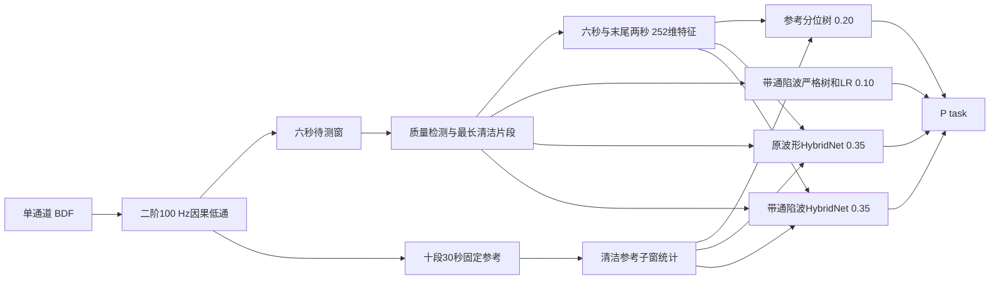

# 模型架构

## H1x5

HybridNet将750点125 Hz波形的卷积池化表示与252维参考Z特征结合。每个网络106169个参数；训练和推理类分别在 `src/models/hybrid.py` 与 `finals/submission/fin/net.py`，测试核验state_dict与输出一致。两类网络各5种子，logit平均后转概率。树分支各3种子，严格分支还融合LR。最终四分支按0.20/0.10/0.35/0.35融合。

## R0

4秒MAD缩放波形同时进入多尺度卷积和可学习能量滤波器，形成144维嵌入；3个随机种子。2/4/6秒窗口165维手工特征经双时间尺度Welford统计变成330维输入LightGBM。两分支logit各0.5，再加0.25倍动态原型相对源原型的增量修正。只对修正前融合logit绝对值超过0.5的当前样本更新伪标签原型，以减小自反馈。

## D2与早期方法

D2使用6秒+2秒252维特征，0.8在线历史分位树与0.2严格先验树/LR晚融合。阶段重排是训练增强及离线压力测试。早期路线保留频谱/时域特征、滤波器组对数协方差、CNN、TCN、BIOT和SingLEM适配，以及切换期训练剔除、权重、软目标和课程实验。

“生理滞后”是训练设计的研究动机；切换初期分类困难不能单独证明其神经机制或每个人的真实滞后时长。缺少电极、设备及可靠受试者ID，幅度与个体差异的解释应保留限制。
